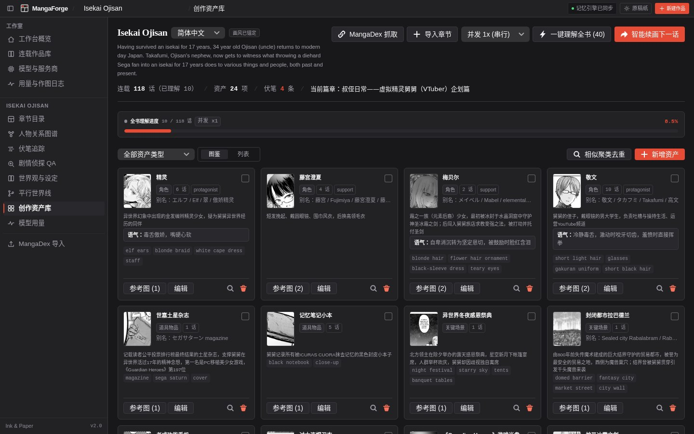
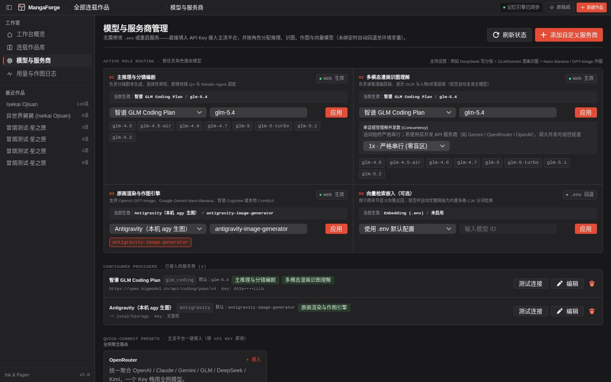
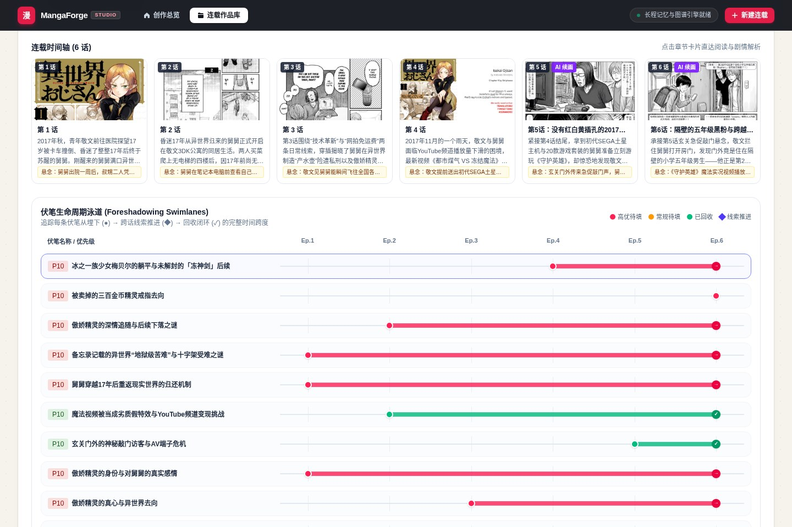
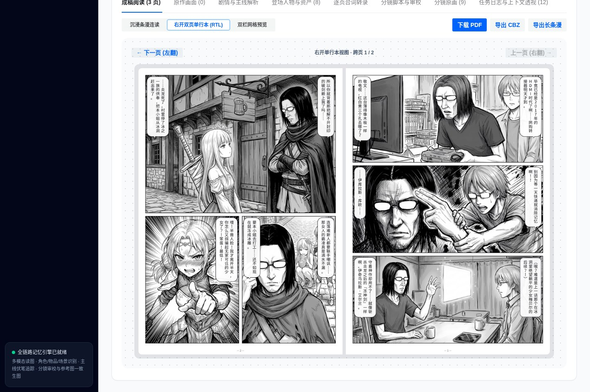
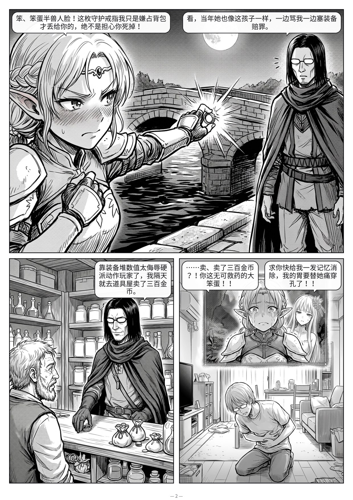
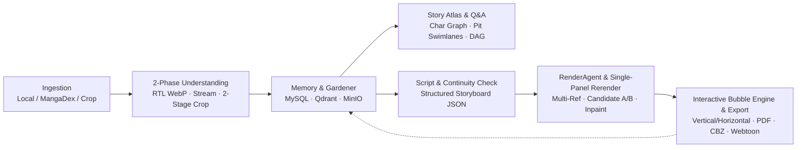
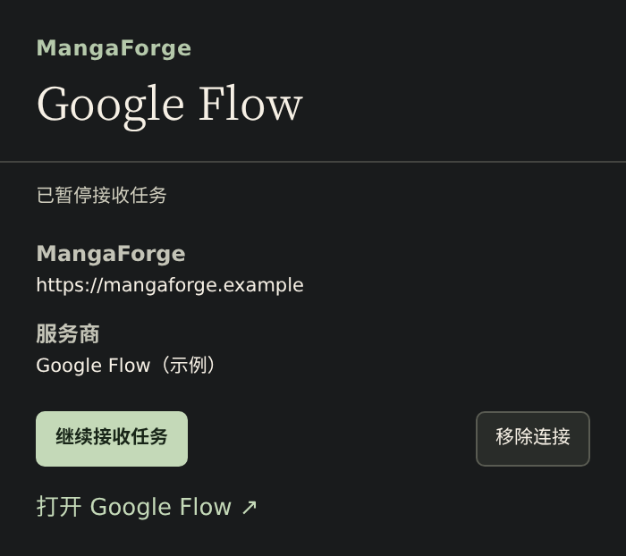

<div align="center">

# MangaForge

Open-source manga continuation & story-intelligence platform with multimodal chapter analysis, hierarchical long-series memory, visual Story Atlas, interactive bubble studio, and multi-format export.

**English** · [简体中文](README.zh-CN.md)

[](#local-development)
[](#architecture)
[](#architecture)
[](LICENSE)

</div>

MangaForge ingests serialized manga chapters (local archives/images or MangaDex), runs a two-phase multimodal reading & precision cropping engine to extract structured narrative graphs and verified visual reference sheets, visualizes characters, arcs, foreshadowing, and story branches in an interactive Story Atlas, and produces reference-locked continuation chapters with traditional vertical CJK or horizontal typesetting exportable as PDF, CBZ, or Webtoon strips.

> [!CAUTION]
> **Do not use MangaForge’s Google Flow browser automation to upload assets or generate images or videos.** During testing, Flow displayed “We noticed some unusual activity” and warned that browser extensions that modify the page may cause issues. [How to pause an installed connector](#pause-the-google-flow-connector)

## Features

- **Two-Phase Multimodal Understanding & 2-Stage Precision Cropping**:
  - **High-Res WebP & RTL Spread Splitting**: Preprocesses pages into crisp WebP blocks with stamped page headers, automatic Right-to-Left (`R → L`) double-page spread splitting, and vertical webtoon strip slicing.
  - **Sequential Notes → Whole-Episode Synthesis**: Phase A reads ordered page windows with streaming (`stream=True`), optional `1360px` HD zoom re-reads, content-filter single-page isolation, and timeout auto-bisection; Phase B synthesizes a single coherent whole-episode JSON (native JSON mode + inner-quote recovery + validation repair) locked to the project's **Preferred Output Language** and series canonical character names.
  - **2-Stage RED/CYAN Pixel-Grid Cropping & Self-Inspection**: Locates faces, items, locations, and outfits on true original-pixel grids, runs `50px` zoomed refinement for character avatars, visually audits all crops via a contact sheet (`ok` / `adjust` / `reject`), guards against cross-character mixups with side-by-side anchor verification, and automatically elects the best primary portrait.
  - **Live Progress Bar & Configurable Concurrency (`1x–8x`)**: Real-time overall/batch progress bar and episode-row `理解中 · XX%` / `排队等待理解` badges (`GET /generation/projects/{id}/understand-progress`). Episodes always execute strictly sequentially to preserve cross-chapter continuity, while intra-episode reading & cropping concurrency can be dialed from `1x` (strict sequential zero blind spots) up to `8x` for high-concurrency API providers.
- **Web-Based Multi-Provider Model Hub (`/models`) & Usage Telemetry (`/usage`)**:
  - Configure 11+ presets (OpenRouter, OpenAI, Anthropic, Gemini, Zhipu GLM / Coding Plan, Kimi, DeepSeek, Qwen, ComfyUI, Antigravity, Custom) in the Web UI with Fernet-encrypted API keys, live connection testing, model discovery, and **4-role routing** (`main_llm`, `vision_llm`, `image_gen`, `embedding`) that overrides `.env` dynamically without restarts.
  - Full token, latency, and Prompt Cache observability across streaming & non-streaming LLM, embedding, and image calls.
- **Hierarchical Long-Series Memory & Memory Gardener**: Combines immutable 10-episode arc digests, tiered world rules (`core_rules` + rolling `discovered_rules`), recent episode windows, multi-query RRF RAG (Qdrant vector search with CJK-aware keyword fallback), and periodic/one-click **Memory Gardener** consolidation (`POST /projects/{id}/memory/consolidate`) to deduplicate assets, prune noise/pits, and re-elect primary portraits across 60–150+ episodes.
- **Iterative Character Lifecycle & Death Locks**: Replays character `vital_status` transitions (`alive` / `injured` / `missing` / `sealed` / `deceased`) chronologically per branch up to the target episode — pinning deceased/unavailable characters into script generation and consistency validation while keeping forked what-if timelines strictly isolated, with manual author override in the Story Atlas UI.
- **Visual Story Atlas & Grounded Story Bible Q&A**:
  - **Character Co-Occurrence & Evolution Graph**: Interactive character constellation graph sized by appearances and weighted by shared scenes, with cropped circular avatars (monochrome `†` portraits for deceased characters), outfit galleries, per-episode state timelines, and one-click vital-status locks (`GET /memory/graph`).
  - **Arc Memory & Foreshadowing Swimlanes**: Timeline ribbon displaying sealed/active arcs, tiered world rules, episode covers, and pit lifecycles (introduction → clue progressions → resolution).
  - **Multiverse Branch DAG**: Visual branch lanes showing forked what-if timelines with per-branch isolated memory and `fork` / `diff` / `merge`.
  - **Story Detective Q&A**: Grounded natural-language search over the ingested manga with matched character avatars and clickable episode citations (`POST /memory/ask`).
- **Precision Generation Studio**:
  - **`@Character` / `#Pit` Director Chips**: Click-to-insert character and open foreshadowing references directly into script instructions, followed by automated continuity validation.
  - **Single-Panel Re-render, Candidate A/B History & Inpainting**: Re-roll individual panels with explicit reference asset overrides while preserving prior versions for one-click A/B switching (`POST /panels/{id}/rerender`, `POST /panels/{id}/select/{image_id}`, `POST /panels/{id}/inpaint`).
  - **Interactive Bubble Canvas & Vertical CJK Manga Lettering**: Supports both traditional vertical right-to-left CJK columns (with vertical punctuation forms and kinsoku shori line-breaking) and horizontal typesetting, `speech` / `shout` (starburst) / `thought` / `whisper` (dashed) / `narration` / `sfx` balloons, drag-and-drop bubble repositioning, and synchronous `<1s` preview re-composition (`2480×3508`).
- **RTL Tankobon Reader & Multi-Format Export**: Vertical scroll, Right-to-Left double-page spread reader, and one-click exports for **PDF**, **CBZ** (with `ComicInfo.xml` manga metadata), and seamless vertical **Webtoon PNG**.

---

## Showcase

End-to-end live workspace on ***Isekai Ojisan* (*Uncle from Another World*)**: 118 MangaDex chapters imported, with the first 10 chapters (Chapters 1–9 incl. 7.5, 213 pages) analyzed sequentially into 5 core characters (9.0–9.5/10 blind-scored portraits), 18 100%-illustrated scene/prop/outfit assets (24 assets total incl. style sheet), and 4 consolidated high-signal plot threads, alongside generated continuation chapters.

### Project Workbench, Asset Library & Model Hub

| Project Workbench (Live Progress Bar & Concurrency) | 100%-Illustrated Visual Asset Library |
| :---: | :---: |
| [](docs/assets/showcase/project_workbench.jpg) | [](docs/assets/showcase/asset_library.jpg) |

| Model Hub (Google Flow connection and four model roles) | Token Usage & Prompt Cache Telemetry |
| :---: | :---: |
| [](docs/assets/showcase/model_hub.jpg) | [](docs/assets/showcase/usage_dashboard.jpg) |

### Visual Story Atlas & Story Detective Q&A

| Character Co-Occurrence & Evolution Graph | Arc Timeline & Foreshadowing Pit Swimlanes |
| :---: | :---: |
| [](docs/assets/showcase/story_atlas_characters.jpg) | [](docs/assets/showcase/story_atlas_timeline.jpg) |

**Grounded Story Bible Q&A** — answers strictly from ingested chapters with clickable episode citations:

[](docs/assets/showcase/story_atlas_qa.jpg)

### Interactive Bubble Studio & RTL Tankobon Reader

| Drag-and-Drop Bubble Studio (Vertical CJK) | Right-to-Left Double-Page Tankobon Reader |
| :---: | :---: |
| [](docs/assets/showcase/bubble_studio.jpg) | [](docs/assets/showcase/rtl_reader.jpg) |

### Traditional Vertical CJK vs. Horizontal Typesetting (Episode 5, Page 1)

| Horizontal Lettering | Traditional Vertical CJK Manga Lettering (Kinsoku + Vertical Punctuation) |
| :---: | :---: |
| [](docs/assets/showcase/ep5_p1.jpg) | [](docs/assets/showcase/ep5_vertical_p1.jpg) |

### Automated 2-Stage Character Portraits & Reference-Locked Rendering

| Uncle (舅舅) | Takafumi (敬文) | Elf (精灵) | Mabel (梅贝尔) | Fujimiya (藤宫澄夏) |
| :---: | :---: | :---: | :---: | :---: |
|  |  |  |  |  |

| Unconditioned (text prompt only) | Reference-conditioned (cropped character & prop sheets) |
| :---: | :---: |
|  |  |

### Generated Continuation — Episode 5 & Episode 6

Episode 5 continues directly from Episode 4's ending; Episode 6 is generated after Episode 5's writeback pass updates project memory and open plot threads *(click any page to view full resolution)*.

**Episode 5**

| Page 1 | Page 2 | Page 3 |
| :---: | :---: | :---: |
| [](docs/assets/showcase/ep5_p1.jpg) | [](docs/assets/showcase/ep5_p2.jpg) | [](docs/assets/showcase/ep5_p3.jpg) |

**Episode 6**

| Page 1 | Page 2 | Page 3 |
| :---: | :---: | :---: |
| [](docs/assets/showcase/ep6_p1.jpg) | [](docs/assets/showcase/ep6_p2.jpg) | [](docs/assets/showcase/ep6_p3.jpg) |

---

## Architecture



- **Backend**: Python 3.12, FastAPI, SQLAlchemy 2.0 (async), Alembic, Pydantic v2, `instructor`
- **Workers**: Celery + Redis (`understand`, `script`, `render`, `layout`, `writeback`, `mangadex` queues)
- **Storage**: MySQL 8.0 (relational state), MinIO (page/panel/reference object storage), Qdrant (optional vector index)
- **Frontend**: React 19, TypeScript, Vite, Semi UI, TailwindCSS, TanStack Query, Zustand

---

## Local Development

### Prerequisites

- [uv](https://docs.astral.sh/uv/) (manages Python 3.12 and virtualenvs)
- Node.js 18+ and npm
- Docker & Docker Compose

### Setup & Run

```bash
# 1. Install backend, worker, and frontend dependencies into .venv and node_modules
make install

# 2. Configure environment variables (set OPENAI_MAX_TOKENS=16384+ for deep-thinking models)
cp .env.example .env

# 3. Start infrastructure (MySQL, Redis, MinIO, Qdrant) and apply migrations
make infra && make migrate

# 4. Start API (:8000) + frontend dev server (:5173), and run Celery worker
make dev
make worker   # run in a separate terminal
```

### Verification

```bash
make lint                         # ruff + tsc --noEmit
.venv/bin/pytest apps/api/tests/  # unit tests
cd apps/web && npm run build      # production bundle check
```

---

## Image Backends

Configured via `IMAGE_BACKEND` in `.env` or per run/panel in the Studio UI. All backends receive matched reference images and character/style metadata:

| `IMAGE_BACKEND` | Integration |
| :--- | :--- |
| `antigravity` | Antigravity `image-generator` (CLI or bridge queue) with multi-reference `ImagePaths` and aspect-ratio matching |
| `comfyui` | Local ComfyUI HTTP workflow API (`COMFYUI_URL`, custom `COMFYUI_WORKFLOW_PATH` placeholder templates & reference upload) |
| `gemini` | Google Interactions API (`gemini-3.1-flash-image` / `gemini-3-pro-image`, up to 14 reference images) |
| `openai` | OpenAI Images API (`gpt-image-2`, reference sheets via `/images/edits`) |
| `custom` | OpenAI-images-compatible HTTP endpoint (`IMAGE_API_URL`) |
| `mock` | Offline placeholder renderer for testing storyboards and bubble layout |

---

<a id="google-flow-with-your-own-browser"></a>

## Pause the Google Flow connector

If the Chrome extension is connected, open **MangaForge · Google Flow** in the toolbar and click **暂停接收任务** (pause new tasks). When the popup shows **已暂停接收任务**, leave it paused. If you use the Python or Ego connector, stop its running process. For questions about a warning on your account, visit the [Google Flow Help Center](https://support.google.com/flow).



<details>
<summary>Archived setup instructions for maintainers</summary>

Use **漫画转视频 → 配置 Flow 扩展** in a chapter, or manage browser connections under **Models → 漫画转视频 · Google Flow**. Video generation uses existing manga pages and the selected Flow video model. It requires no image-generation model.

1. Download and unzip **MangaForge Flow**. In the intended Chrome profile, open `chrome://extensions`, enable Developer mode, click **Load unpacked** and select the directory containing `manifest.json`.
2. Generate an **extension access token** in Models. Enter your MangaForge URL and token in the extension and click **连接 MangaForge**.
3. Select your Google account in the Flow tab you want to use, then start the task in the chapter. Keep the browser and Flow tab open. The extension polls your instance, uploads references, enters the shot prompts and returns the generated media. You can switch Google accounts in Flow and keep the same MangaForge token.

If Flow asks you to confirm your rights to an image, MangaForge shows the pending confirmation in the chapter. Choose **I agree** in the same Flow tab to continue the upload, or **Cancel** to stop.

To upgrade an unpacked extension, overwrite the files in its existing directory and click **Reload** in `chrome://extensions`. This preserves the token, job records and pause setting.

The revocable token is scoped to one Flow provider. Use HTTPS on shared networks and protect the Models dashboard with your deployment's access controls. [Google Flow](https://flow.google.com/)

<details><summary>Existing Python and Ego connectors</summary>

- **Ego Lite on a Mac**. On the Linux host paired to that Mac, check `ego-browser bridge status`, run `make flow-ego` from the MangaForge checkout and paste the pairing string. To choose a particular profile, run `python3 scripts/flow_ego.py --profile 'Exact profile name'` when pairing or switching. A profile can contain multiple Google accounts. Select the intended account in Flow before pairing. The connector pins the profile and checks the selected account before submitting. To change accounts, switch in Flow and run `python3 scripts/flow_ego.py --pair` with a fresh pairing string. The Mac transfers assets directly to and from your MangaForge server. Keep the Mac awake with Ego Lite, Ego Bridge and the connector running. If Flow asks you to sign in, complete login in the dedicated tab and run `make flow-ego-resume`.
- **Dedicated Chrome**. Download the Python connector from Models. On a computer with Chrome and Python 3.10+, run `python -m pip install playwright` and then `python mangaforge_flow.py`. Paste the pairing string and sign in to Google in the dedicated window as prompted. Use `--login` to sign in again.

Use a server address reachable from the Mac, and HTTPS on a shared network. Check the active Google account in Flow before spending credits. [Google’s project and asset guide](https://support.google.com/flow/answer/16935308?hl=en)

</details>

Open **漫画转视频** in a chapter and select the Flow connection and video model. Video uses the existing pages. Review the numbered references and edit the prompts. **仅同步素材** creates or reuses a Flow project for this manga and uploads its reference images. If the original connection was replaced, **用当前连接重新同步素材** starts a fresh upload. **生成本话视频** also generates eight-second clips using the credits of the account you selected in Flow. The worker joins the clips locally with FFmpeg and saves an MP4. Check any uncertain submission in the original Flow project before retrying. [Flow video controls](https://support.google.com/flow/answer/16353334?hl=en) · [Local browser automation reference](https://github.com/GTAI-1/flow-mcp)

To draw new storyboard panels with Nano Banana, you can separately assign Flow to the **image_gen** role.

</details>

## Documentation

- Architecture & roadmap: [`docs/architecture.md`](docs/architecture.md) · [`docs/design.md`](docs/design.md) · [`docs/ROADMAP.md`](docs/ROADMAP.md) · [`docs/PRD.md`](docs/PRD.md)
- Environment reference: [`.env.example`](.env.example) (`OPENAI_EMBEDDING_MODEL` is optional; retrieval falls back to keyword search when unset)
- OpenAPI / Swagger UI: `http://localhost:8000/docs`

## License

[MIT License](LICENSE)
