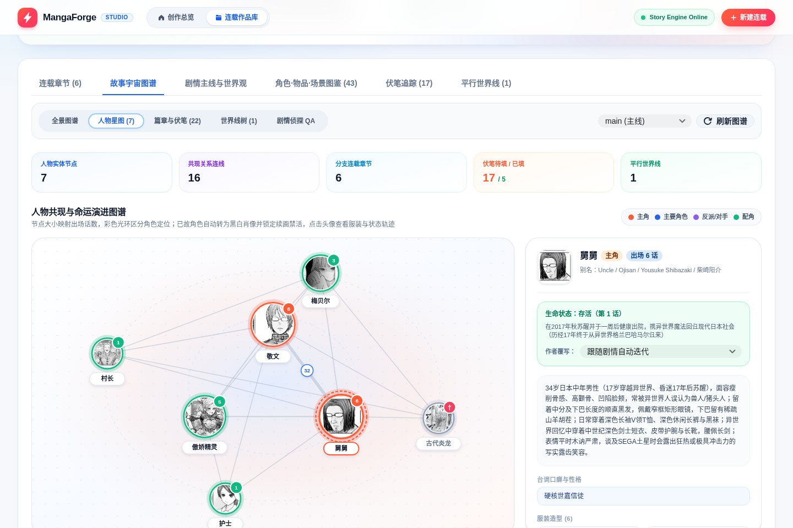
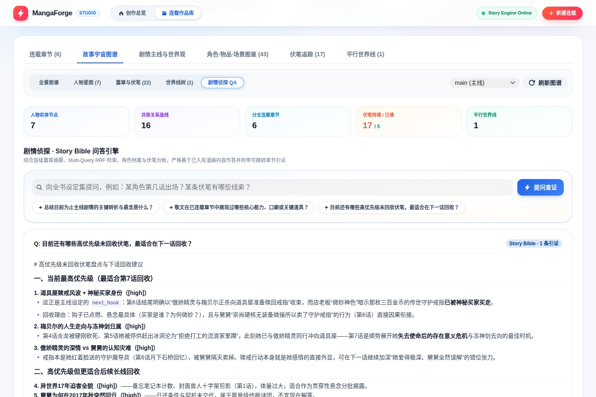
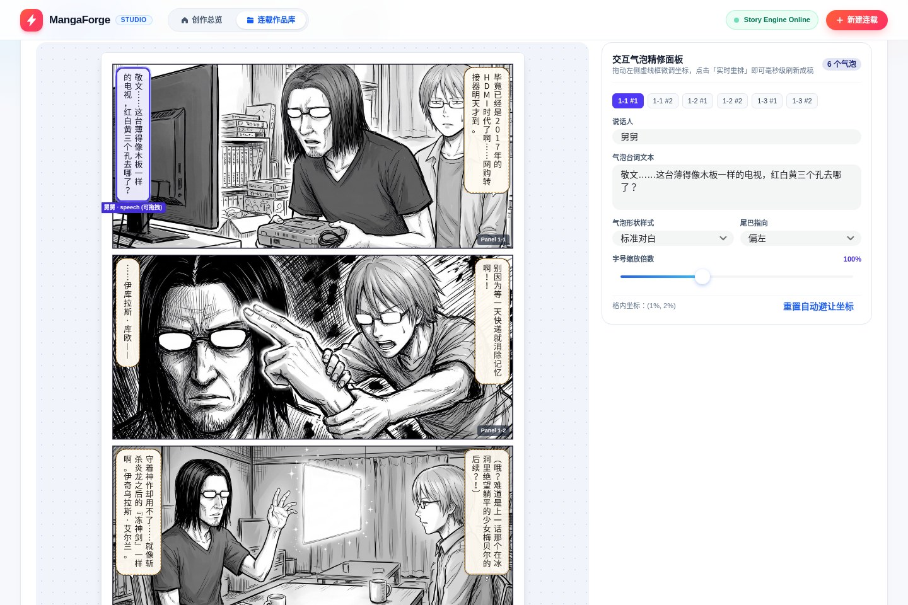
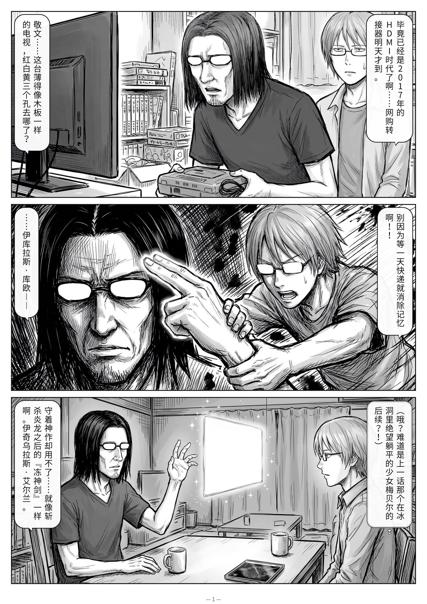
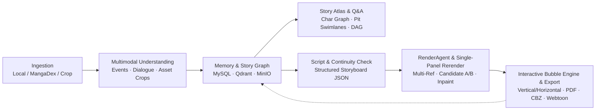

<div align="center">

# MangaForge

Open-source manga continuation & story-intelligence platform with multimodal chapter analysis, hierarchical long-series memory, visual Story Atlas, interactive bubble studio, and multi-format export.

**English** · [简体中文](README.zh-CN.md)

[](#local-development)
[](#architecture)
[](#architecture)
[](LICENSE)

</div>

MangaForge ingests serialized manga chapters (local archives/images or MangaDex), extracts structured narrative graphs and cropped visual reference sheets via multimodal LLMs, visualizes characters, arcs, foreshadowing, and story branches in an interactive Story Atlas, and produces reference-locked continuation chapters with traditional vertical CJK or horizontal typesetting exportable as PDF, CBZ, or Webtoon strips.

## Features

- **Chapter Ingestion & Multimodal Analysis**: Batch import from local files/ZIPs or MangaDex; extracts synopses, chronological events, character state transitions, page-level dialogue, and bounding-box crops for characters, outfits, and recurring props — plus an interactive page-to-asset visual cropper (`POST /assets/{id}/crop-from-page`).
- **Hierarchical Long-Series Memory**: Combines immutable 10-episode arc digests, tiered world rules (`core_rules` + rolling `discovered_rules`), recent episode windows, and multi-query RRF RAG (Qdrant vector search with CJK-aware keyword fallback) to support 60–150+ episode series without context truncation.
- **Iterative Character Lifecycle & Death Locks**: Replays character `vital_status` transitions (`alive` / `injured` / `missing` / `sealed` / `deceased`) chronologically per branch up to the target episode — pinning deceased/unavailable characters into script generation and consistency validation (even 50+ chapters later) while keeping forked what-if timelines strictly isolated, with manual author override in the Story Atlas UI.
- **Visual Story Atlas & Grounded Story Bible Q&A**:
  - **Character Co-Occurrence & Evolution Graph**: Interactive character constellation graph sized by appearances and weighted by shared scenes, with cropped circular avatars (monochrome `†` portraits for deceased characters), outfit galleries, per-episode state timelines, and one-click vital-status locks (`GET /memory/graph`).
  - **Arc Memory & Foreshadowing Swimlanes**: Timeline ribbon displaying sealed/active arcs, tiered world rules, episode covers, and pit lifecycles (introduction → clue progressions → resolution).
  - **Multiverse Branch DAG**: Visual branch lanes showing forked what-if timelines with per-branch isolated memory and `fork` / `diff` / `merge`.
  - **Story Detective Q&A**: Grounded natural-language search over the ingested manga with thinking-model `OPENAI_MAX_TOKENS` support, matched character avatars, and clickable episode citations (`POST /memory/ask`).
- **Precision Generation Studio**:
  - **`@Character` / `#Pit` Director Chips**: Click-to-insert character and open foreshadowing references directly into script instructions, followed by automated continuity validation.
  - **Single-Panel Re-render, Candidate A/B History & Inpainting**: Re-roll individual panels with explicit reference asset overrides while preserving prior versions for one-click A/B switching (`POST /panels/{id}/rerender`, `POST /panels/{id}/select/{image_id}`, `POST /panels/{id}/inpaint`).
  - **Interactive Bubble Canvas & Vertical CJK Manga Lettering**: Supports both traditional vertical right-to-left CJK columns (with vertical punctuation forms and kinsoku shori line-breaking) and horizontal typesetting, `speech` / `shout` (starburst) / `thought` / `whisper` (dashed) / `narration` / `sfx` balloons, drag-and-drop bubble repositioning, and synchronous `<1s` preview re-composition (`2480×3508`).
- **RTL Tankobon Reader & Multi-Format Export**: Vertical scroll, Right-to-Left double-page spread reader, and one-click exports for **PDF**, **CBZ** (with `ComicInfo.xml` manga metadata), and seamless vertical **Webtoon PNG**.

---

## Showcase

End-to-end live workspace on ***Isekai Ojisan* (*Uncle from Another World*)**: Chapters 1–4 (83 pages) imported from MangaDex, analyzed into 43 visual assets, 20 world rules, and 22 tracked plot threads, followed by two consecutive generated continuation chapters (Episodes 5 & 6).

### Visual Story Atlas & Story Detective Q&A

| Character Co-Occurrence & Evolution Graph | Arc Timeline & Foreshadowing Pit Swimlanes |
| :---: | :---: |
| [](docs/assets/showcase/story_atlas_characters.jpg) | [](docs/assets/showcase/story_atlas_timeline.jpg) |

**Grounded Story Bible Q&A** — answers strictly from ingested chapters with clickable episode citations:

[](docs/assets/showcase/story_atlas_qa.jpg)

### Interactive Bubble Studio & RTL Tankobon Reader

| Drag-and-Drop Bubble Studio (Vertical CJK) | Right-to-Left Double-Page Tankobon Reader |
| :---: | :---: |
| [](docs/assets/showcase/bubble_studio.jpg) | [](docs/assets/showcase/rtl_reader.jpg) |

### Traditional Vertical CJK vs. Horizontal Typesetting (Episode 5, Page 1)

| Horizontal Lettering | Traditional Vertical CJK Manga Lettering (Kinsoku + Vertical Punctuation) |
| :---: | :---: |
| [](docs/assets/showcase/ep5_p1.jpg) | [](docs/assets/showcase/ep5_vertical_p1.jpg) |

### Extracted Visual Assets & Reference-Locked Rendering

| Uncle | Takafumi | Tsundere Elf | Mabel | SEGA Saturn Pad |
| :---: | :---: | :---: | :---: | :---: |
|  |  |  |  |  |

| Unconditioned (text prompt only) | Reference-conditioned (cropped character & prop sheets) |
| :---: | :---: |
|  |  |

### Generated Continuation — Episode 5 & Episode 6

Episode 5 continues directly from Episode 4's ending; Episode 6 is generated after Episode 5's writeback pass updates project memory and open plot threads *(click any page to view full resolution)*.

**Episode 5**

| Page 1 | Page 2 | Page 3 |
| :---: | :---: | :---: |
| [](docs/assets/showcase/ep5_p1.jpg) | [](docs/assets/showcase/ep5_p2.jpg) | [](docs/assets/showcase/ep5_p3.jpg) |

**Episode 6**

| Page 1 | Page 2 | Page 3 |
| :---: | :---: | :---: |
| [](docs/assets/showcase/ep6_p1.jpg) | [](docs/assets/showcase/ep6_p2.jpg) | [](docs/assets/showcase/ep6_p3.jpg) |

---

## Architecture



- **Backend**: Python 3.12, FastAPI, SQLAlchemy 2.0 (async), Alembic, Pydantic v2, `instructor`
- **Workers**: Celery + Redis (`understand`, `script`, `render`, `layout`, `writeback`, `mangadex` queues)
- **Storage**: MySQL 8.0 (relational state), MinIO (page/panel/reference object storage), Qdrant (optional vector index)
- **Frontend**: React 19, TypeScript, Vite, Semi UI, TailwindCSS, TanStack Query, Zustand

---

## Local Development

### Prerequisites

- [uv](https://docs.astral.sh/uv/) (manages Python 3.12 and virtualenvs)
- Node.js 18+ and npm
- Docker & Docker Compose

### Setup & Run

```bash
# 1. Install backend, worker, and frontend dependencies into .venv and node_modules
make install

# 2. Configure environment variables (set OPENAI_MAX_TOKENS=16384+ for deep-thinking models)
cp .env.example .env

# 3. Start infrastructure (MySQL, Redis, MinIO, Qdrant) and apply migrations
make infra && make migrate

# 4. Start API (:8000) + frontend dev server (:5173), and run Celery worker
make dev
make worker   # run in a separate terminal
```

### Verification

```bash
make lint                         # ruff + tsc --noEmit
.venv/bin/pytest apps/api/tests/  # unit tests
cd apps/web && npm run build      # production bundle check
```

---

## Image Backends

Configured via `IMAGE_BACKEND` in `.env` or per run/panel in the Studio UI. All backends receive matched reference images and character/style metadata:

| `IMAGE_BACKEND` | Integration |
| :--- | :--- |
| `antigravity` | Antigravity `image-generator` (CLI or bridge queue) with multi-reference `ImagePaths` and aspect-ratio matching |
| `comfyui` | Local ComfyUI HTTP workflow API (`COMFYUI_URL`, custom `COMFYUI_WORKFLOW_PATH` placeholder templates & reference upload) |
| `gemini` | Google Interactions API (`gemini-3.1-flash-image` / `gemini-3-pro-image`, up to 14 reference images) |
| `openai` | OpenAI Images API (`gpt-image-2`, reference sheets via `/images/edits`) |
| `custom` | OpenAI-images-compatible HTTP endpoint (`IMAGE_API_URL`) |
| `mock` | Offline placeholder renderer for testing storyboards and bubble layout |

---

## Documentation

- Architecture & roadmap: [`docs/architecture.md`](docs/architecture.md) · [`docs/design.md`](docs/design.md) · [`docs/ROADMAP.md`](docs/ROADMAP.md) · [`docs/PRD.md`](docs/PRD.md)
- Environment reference: [`.env.example`](.env.example) (`OPENAI_EMBEDDING_MODEL` is optional; retrieval falls back to keyword search when unset)
- OpenAPI / Swagger UI: `http://localhost:8000/docs`

## License

[MIT License](LICENSE)
