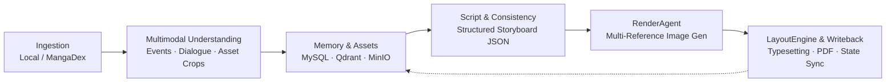

<div align="center">

# MangaForge

Open-source manga continuation platform with multimodal chapter understanding, hierarchical story memory, visual reference indexing, and page typesetting.

**English** · [简体中文](README.zh-CN.md)

[](#local-development)
[](#architecture)
[](#architecture)
[](LICENSE)

</div>

MangaForge ingests existing manga chapters (local archives/images or MangaDex), extracts structured narrative state and cropped visual reference sheets via multimodal LLMs, maintains long-range continuity across episodes and story branches, and generates typeset continuation chapters exportable as PNG or PDF.

## Features

- **Chapter Ingestion & Multimodal Analysis**: Batch import from local files/ZIPs or MangaDex; extracts synopses, chronological events, character state transitions, page-level dialogue, and bounding-box crops for characters, outfits, and recurring props.
- **Hierarchical Long-Series Memory**: Combines immutable 10-episode arc digests, tiered world rules (`core_rules` + rolling `discovered_rules`), recent episode windows, and multi-query RAG (Qdrant vector search with CJK-aware keyword fallback) to support 60–150+ episode series without context truncation.
- **Foreshadowing (`Pit`) Tracking & Continuity Check**: Tracks open, progressed, and resolved plot threads across chapters; validates generated storyboards against world rules and character states before rendering.
- **Reference-Locked Rendering & Page Typesetting**: Tool-calling `RenderAgent` attaches matched character/prop/style reference crops per panel with layout-matched aspect ratios; `LayoutEngine` composites panels, speech/thought/narration balloons, and SFX into print-resolution pages (`2480×3508`).
- **Branching Timelines**: Episode DAG with `fork`, `diff`, and `merge` support, isolating story memory and plot-thread state per branch.

---

## Showcase

Example run on ***Isekai Ojisan* (*Uncle from Another World*)**: Chapters 1–4 (83 pages) imported from MangaDex, analyzed into 43 visual assets and 20 world rules, followed by two consecutive generated chapters (Episodes 5 & 6).

### Extracted Visual Assets (Chapters 1–4)

| Uncle | Takafumi | Tsundere Elf | Mabel | SEGA Saturn Pad |
| :---: | :---: | :---: | :---: | :---: |
|  |  |  |  |  |

### Reference-Conditioned Panel Generation

| Unconditioned (text prompt only) | Reference-conditioned (cropped character & prop sheets) |
| :---: | :---: |
|  |  |

### Generated Continuation — Episode 5 & Episode 6

Episode 5 continues directly from Episode 4's ending; Episode 6 is generated after Episode 5's writeback pass updates project memory and open plot threads *(click any page to view full resolution)*.

**Episode 5**

| Page 1 | Page 2 | Page 3 |
| :---: | :---: | :---: |
| [](docs/assets/showcase/ep5_p1.jpg) | [](docs/assets/showcase/ep5_p2.jpg) | [](docs/assets/showcase/ep5_p3.jpg) |

**Episode 6**

| Page 1 | Page 2 | Page 3 |
| :---: | :---: | :---: |
| [](docs/assets/showcase/ep6_p1.jpg) | [](docs/assets/showcase/ep6_p2.jpg) | [](docs/assets/showcase/ep6_p3.jpg) |

---

## Architecture



- **Backend**: Python 3.12, FastAPI, SQLAlchemy 2.0 (async), Alembic, Pydantic v2, `instructor`
- **Workers**: Celery + Redis (`understand`, `script`, `render`, `layout`, `writeback`, `mangadex` queues)
- **Storage**: MySQL 8.0 (relational state), MinIO (page/panel/reference object storage), Qdrant (optional vector index)
- **Frontend**: React 19, TypeScript, Vite, Semi UI, TailwindCSS, TanStack Query, Zustand

---

## Local Development

### Prerequisites

- [uv](https://docs.astral.sh/uv/) (manages Python 3.12 and virtualenvs)
- Node.js 18+ and npm
- Docker & Docker Compose

### Setup & Run

```bash
# 1. Install backend, worker, and frontend dependencies into .venv and node_modules
make install

# 2. Configure environment variables
cp .env.example .env

# 3. Start infrastructure (MySQL, Redis, MinIO, Qdrant) and apply migrations
make infra && make migrate

# 4. Start API (:8000) + frontend dev server (:5173), and run Celery worker
make dev
make worker   # run in a separate terminal
```

### Verification

```bash
make lint                         # ruff + tsc --noEmit
.venv/bin/pytest apps/api/tests/  # unit tests
```

---

## Image Backends

Configured via `IMAGE_BACKEND` in `.env` or per run in the Studio UI. All backends receive matched reference images and character/style metadata:

| `IMAGE_BACKEND` | Integration |
| :--- | :--- |
| `antigravity` | Antigravity `image-generator` (CLI or bridge queue) with multi-reference `ImagePaths` and aspect-ratio matching |
| `gemini` | Google Interactions API (`gemini-3.1-flash-image` / `gemini-3-pro-image`, up to 14 reference images) |
| `openai` | OpenAI Images API (`gpt-image-2`, reference sheets via `/images/edits`) |
| `custom` | OpenAI-images-compatible HTTP endpoint (`IMAGE_API_URL`) |
| `mock` | Offline placeholder renderer for testing storyboards and bubble layout |

---

## Documentation

- Architecture & data model: [`docs/architecture.md`](docs/architecture.md) · [`docs/design.md`](docs/design.md) · [`docs/PRD.md`](docs/PRD.md)
- Environment reference: [`.env.example`](.env.example) (`OPENAI_EMBEDDING_MODEL` is optional; retrieval falls back to keyword search when unset)
- OpenAPI / Swagger UI: `http://localhost:8000/docs`

## License

[MIT License](LICENSE)
