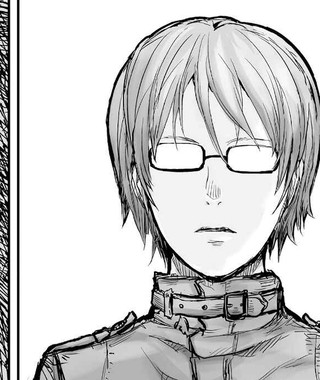
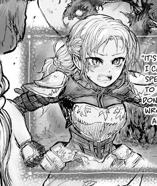
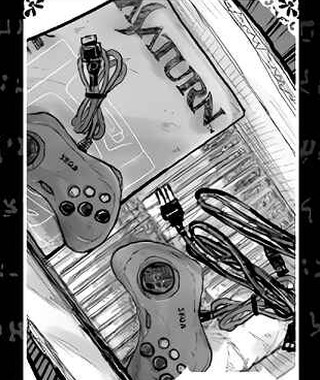
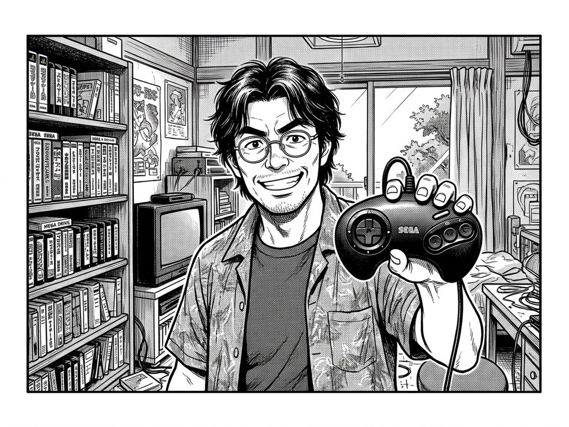
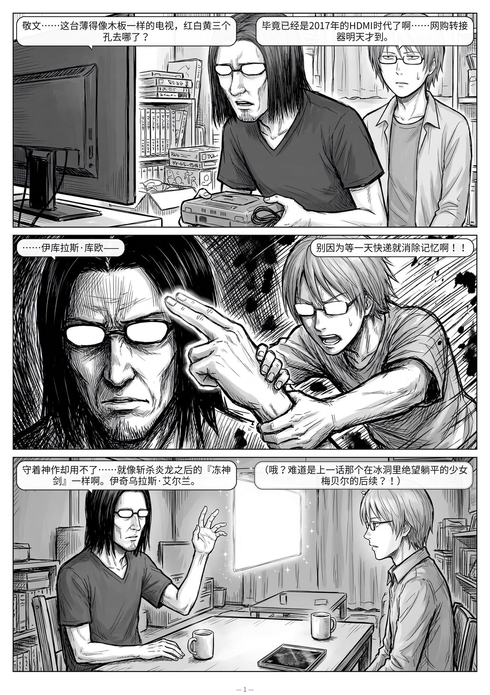
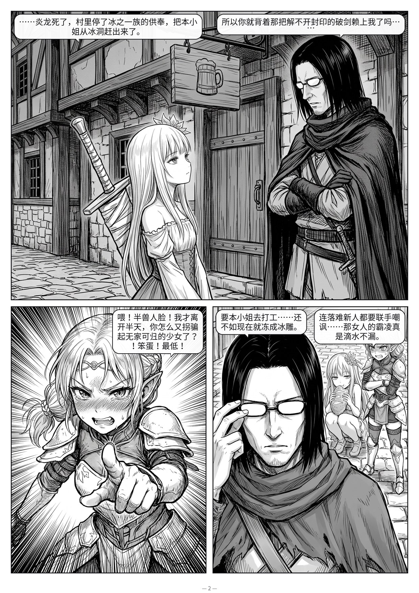
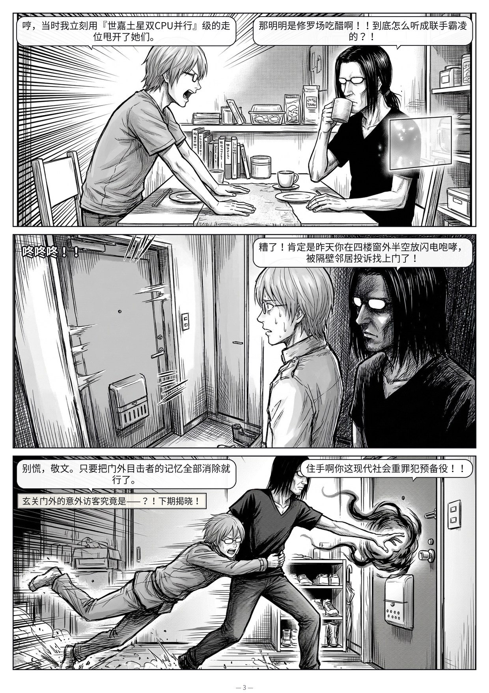
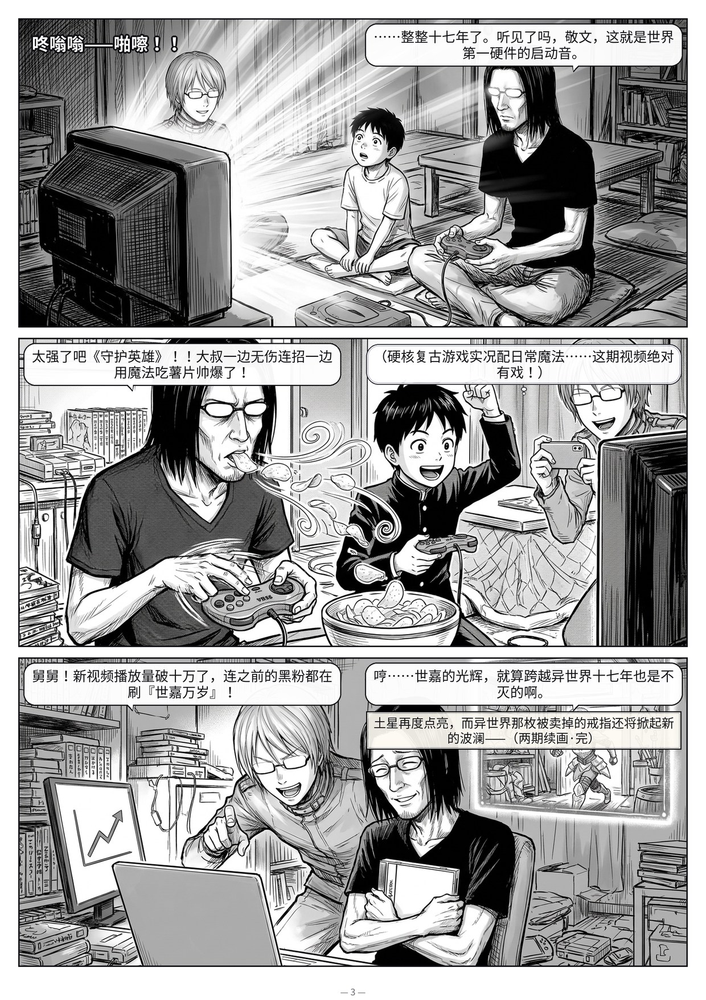
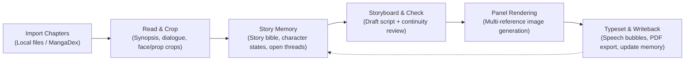

<div align="center">

# MangaForge

Continue an ongoing manga without the characters changing faces every three panels.

**English** · [简体中文](README.zh-CN.md)

</div>

Most "AI manga" demos fall apart the moment you try to make chapter two. Characters drift off-model, key props morph into something else, and the writer LLM forgets half the setup from three chapters back.

MangaForge is a self-hosted studio built around how serialized manga actually works: it reads existing chapters first, crops real character faces and recurring props straight out of the original pages, tracks unresolved plot threads, and feeds those visual + narrative references into every new page it draws. You can also fork any chapter into an alternate timeline ("what if he actually understood what the elf meant?") without polluting the main story.

---

## Example: Continuing *Uncle from Another World* (*Isekai Ojisan*)

To test the full loop, we imported **Chapters 1–4 (83 pages)** of *Isekai Ojisan* from MangaDex, let MangaForge read them in order, and asked it to write and draw **two consecutive new chapters (Chapters 5 & 6)**.

### Step 1 — Reading the manga & cropping real references

From those first four chapters, the vision pass extracted the world rules (Granbahamal's language, memory-erasure magic, SEGA Saturn obsession) and cropped 43 character, outfit, and prop references directly from the interior pages:

| Uncle | Takafumi | Tsundere Elf | Mabel | SEGA Saturn Pad |
| :---: | :---: | :---: | :---: | :---: |
|  |  |  |  |  |

Why bother cropping from the source pages? Here is what happened on the exact same scene before and after attaching those crops:

| Text prompt only (no manga crops) | With cropped face & Saturn references attached |
| :---: | :---: |
|  |  |
| Turned Uncle into a cheerful, handsome guy with wavy hair and round glasses—and gave him a 3-button Mega Drive pad instead of a Saturn controller. | Flat center-parted hair, gaunt cheeks, narrow white-glare glasses, 6-button Saturn pad, and Hotondoshindeiru's heavy pen crosshatching. |

### Step 2 — First generated chapter (Chapter 5)

Chapter 4 ends with Takafumi gifting Uncle a grey SEGA Saturn bundle in November 2017. Chapter 5 picks up five minutes later: Uncle discovers a 2017 flatscreen TV has no red-white-yellow RCA jacks, nearly wipes his own memory so he won't feel the pain of waiting a day for an HDMI adapter, and projects a flashback of what happened to Mabel after he skipped her ice-sword quest—until someone starts pounding on the apartment door.

*(Click any page to read full size; dialogue was generated in Chinese for this run.)*

| Page 1 | Page 2 | Page 3 |
| :---: | :---: | :---: |
| [](docs/assets/showcase/ep5_p1.jpg) | [](docs/assets/showcase/ep5_p2.jpg) | [](docs/assets/showcase/ep5_p3.jpg) |

### Step 3 — Second generated chapter (Chapter 6, building on Chapter 5)

Once Chapter 5 finished rendering, MangaForge wrote its events and cliffhanger back into memory and generated Chapter 6 on top of it. Opening the front door reveals the kid next door—who turns out to be `"Rapha-L"`, the 5th-grader who mocked Uncle's YouTube videos as fake CGI back in Chapter 2 before seeing Uncle shoot real lightning off the balcony in Chapter 4. Terrified, the kid offers his grandpa's old CRT TV as a peace offering, finally letting the Saturn boot up after seventeen years.

| Page 1 | Page 2 | Page 3 |
| :---: | :---: | :---: |
| [](docs/assets/showcase/ep6_p1.jpg) | [](docs/assets/showcase/ep6_p2.jpg) | [](docs/assets/showcase/ep6_p3.jpg) |

---

## How It Works



- **Visual grounding over text descriptions.** When MangaForge reads a chapter, it records bounding boxes for characters, outfits, and key items so future panels pull actual drawings from the manga—not just adjectives. It also samples interior pages rather than volume covers so color cover art doesn't bleed into black-and-white chapters.
- **Plot memory that survives past five chapters.** Context combines canon world rules, a rolling compressed summary, detailed recent chapters, and an explicit list of open plot threads ("pits") so planted setups get paid off instead of forgotten. Every generated script goes through a continuity check before a single pixel is rendered.
- **Manga-native layout and typesetting.** Panels are generated at aspect ratios matching their target frame on the page, then composed with speech balloons, thought bubbles, narration boxes, and sound effects placed according to speaker position, ready to export as PNGs or a chapter PDF.
- **Branching timelines.** Episodes form a tree rather than a flat list. You can fork from any chapter to try a different story direction with isolated memory and thread state.

---

## Getting Started

You'll need [uv](https://docs.astral.sh/uv/) (handles Python 3.12 automatically), Node.js 18+, and Docker Compose.

```bash
# 1. Install Python & frontend dependencies
make install

# 2. Configure API keys and models
cp .env.example .env

# 3. Start MySQL, Redis, MinIO, and Qdrant, then run migrations
make infra && make migrate

# 4. Run the web app, API server, and background worker
make dev      # Web UI on http://localhost:5173 · API docs on http://localhost:8000/docs
make worker   # Run in a second terminal for understanding & rendering jobs
```

---

## Pluggable Image Backends

Switch backends in `.env` (`IMAGE_BACKEND=...`) or per run inside the web studio. All backends receive matched character, prop, and style references:

| Backend | What it uses |
| :--- | :--- |
| `antigravity` | Google Antigravity `image-generator` with local multi-reference `ImagePaths` and panel aspect-ratio matching |
| `gemini` | Nano Banana models (`gemini-3.1-flash-image` / `gemini-3-pro-image`) via the Interactions API (up to 14 reference images) |
| `openai` | OpenAI Images API (`gpt-image-2`, etc.), passing reference sheets through `/images/edits` |
| `custom` | Any OpenAI-images-compatible HTTP endpoint (`IMAGE_API_URL`) |
| `mock` | Local monochrome screentone placeholder renderer for testing scripts and bubble layout offline |

---

## More Details

- Architecture & data model notes: [`docs/architecture.md`](docs/architecture.md) · [`docs/design.md`](docs/design.md) · [`docs/PRD.md`](docs/PRD.md)
- All environment variables: [`.env.example`](.env.example) *(embeddings are optional—leave `OPENAI_EMBEDDING_MODEL` blank to fall back to keyword retrieval)*
- Interactive API docs: `http://localhost:8000/docs` once `make api` is running

## License

For research and personal experimentation. Please respect the rights of original manga creators when importing or working with copyrighted material.
