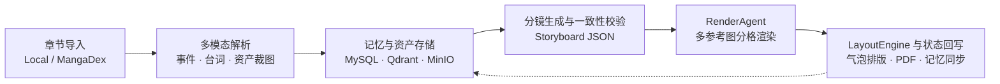

<div align="center">

# MangaForge

开源 AI 漫画续画平台，集成原漫多模态理解、分层长程记忆、视觉参考图索引与分格气泡排版。

[English](README.md) · **简体中文**

[](#本地开发)
[](#系统架构)
[](#系统架构)
[](LICENSE)

</div>

MangaForge 支持从本地图片/压缩包或 MangaDex 导入连载漫画，通过多模态模型提取剧情结构并裁剪角色与道具参考图，维护跨章节与多分支的叙事状态及伏笔池，生成角色一致的续画分镜并自动完成对白排版与 PNG/PDF 导出。

## 功能特性

- **章节导入与多模态解析**：支持本地文件/ZIP 上传及 MangaDex 批量抓取；自动提取单话摘要、关键事件、人物状态变更、逐页台词，并按检测框自动裁剪角色、服装与关键道具参考图。
- **分层长程记忆与多路召回**：采用“10 话不可变篇章纪要 + 核心/演进分级世界观规则 + 近期章节滑窗 + 多路 RRF 检索（Qdrant 向量检索与中文关键词回退）”架构，支持 60～150+ 话长连载上下文组装且不丢失早期设定。
- **伏笔（Pit）生命周期与一致性校验**：跨章节追踪伏笔的埋设、推进与回收；分镜脚本生成后自动对照世界观规则与角色当前状态执行一致性审查，存在冲突时自动带反馈重生。
- **多参考图生图与页面排版**：`RenderAgent` 按分格检索并挂载角色/道具/画风参考图，自适应分格横竖构图比例；`LayoutEngine` 自动完成分格拼版、对白/心声/旁白气泡与拟声词嵌字（输出 `2480×3508` 成稿及整话 PDF）。
- **多分支剧情线（Branch / Fork）**：章节采用 DAG 父指针结构，支持从任意章节 `fork`、`diff` 与 `merge` 独立剧情支线，记忆与伏笔状态按分支血统严格隔离。

---

## 生成示例

以下为《异世界舅舅》(Isekai Ojisan) 端到端运行结果：从 MangaDex 导入第 1～4 话（83 页），自动解析入库 43 项视觉资产与 20 条世界观规则，随后连续生成第 5 话与第 6 话。

### 自动提取的视觉参考资产（第 1～4 话）

| 舅舅 | 敬文 | 傲娇精灵 | 梅贝尔 | SEGA 土星手柄 |
| :---: | :---: | :---: | :---: | :---: |
|  |  |  |  |  |

### 参考图约束生图对比

| 无参考图（仅文本 Prompt） | 挂载原漫裁剪的角色与道具参考图 |
| :---: | :---: |
|  |  |

### 连续两期续画成稿（第 5 话 & 第 6 话）

第 5 话承接第 4 话结尾生成；第 5 话经 `writeback` 回写记忆与新增伏笔后，基于更新后的上下文继续生成第 6 话（点击任意页面可查看原图）。

**第 5 话**

| 第 1 页 | 第 2 页 | 第 3 页 |
| :---: | :---: | :---: |
| [](docs/assets/showcase/ep5_p1.jpg) | [](docs/assets/showcase/ep5_p2.jpg) | [](docs/assets/showcase/ep5_p3.jpg) |

**第 6 话**

| 第 1 页 | 第 2 页 | 第 3 页 |
| :---: | :---: | :---: |
| [](docs/assets/showcase/ep6_p1.jpg) | [](docs/assets/showcase/ep6_p2.jpg) | [](docs/assets/showcase/ep6_p3.jpg) |

---

## 系统架构



- **后端服务**：Python 3.12、FastAPI、SQLAlchemy 2.0 (async)、Alembic、Pydantic v2、`instructor`
- **异步任务**：Celery + Redis（`understand`、`script`、`render`、`layout`、`writeback`、`mangadex` 队列）
- **存储组件**：MySQL 8.0（业务与记忆数据）、MinIO（原漫页/渲染图/参考图对象存储）、Qdrant（可选向量索引）
- **前端应用**：React 19、TypeScript、Vite、Semi UI、TailwindCSS、TanStack Query、Zustand

---

## 本地开发

### 环境依赖

- [uv](https://docs.astral.sh/uv/)（自动管理 Python 3.12 与虚拟环境）
- Node.js 18+ 与 npm
- Docker 与 Docker Compose

### 启动步骤

```bash
# 1. 安装后端、Worker 与前端依赖（根目录统一创建 .venv）
make install

# 2. 配置环境变量
cp .env.example .env

# 3. 启动基础组件（MySQL / Redis / MinIO / Qdrant）并执行数据库迁移
make infra && make migrate

# 4. 启动 API (:8000) 与前端开发服务 (:5173)，并运行 Celery Worker
make dev
make worker   # 在独立终端运行后台任务队列
```

### 代码检查与测试

```bash
make lint                         # ruff + tsc --noEmit
.venv/bin/pytest apps/api/tests/  # 后端单元测试
```

---

## 图像生成后端

可通过 `.env` 中的 `IMAGE_BACKEND` 或前端工作台按次指定，所有后端均支持传入匹配的角色、道具与画风参考图：

| `IMAGE_BACKEND` | 对接方式 |
| :--- | :--- |
| `antigravity` | 调用 Antigravity `image-generator`（支持 CLI 或 Bridge 队列），传入本地多参考图 `ImagePaths` 并匹配分格比例 |
| `gemini` | Google Interactions API（`gemini-3.1-flash-image` / `gemini-3-pro-image`，单格最多 14 张参考图） |
| `openai` | OpenAI Images API（`gpt-image-2` 等，参考图走 `/images/edits`） |
| `custom` | 兼容 OpenAI Images 协议的自定义 HTTP 接口（`IMAGE_API_URL`） |
| `mock` | 本地离线占位渲染器，用于调试分镜脚本与气泡排版 |

---

## 相关文档

- 架构与模型设计：[`docs/architecture.md`](docs/architecture.md) · [`docs/design.md`](docs/design.md) · [`docs/PRD.md`](docs/PRD.md)
- 环境变量参考：[`.env.example`](.env.example)（`OPENAI_EMBEDDING_MODEL` 为可选项，留空时自动降级为关键词检索）
- OpenAPI 文档：启动后端后访问 `http://localhost:8000/docs`

## 开源协议

[MIT License](LICENSE)
