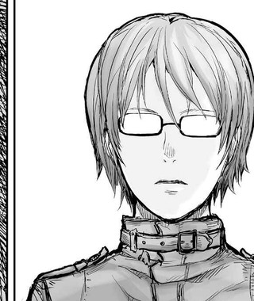
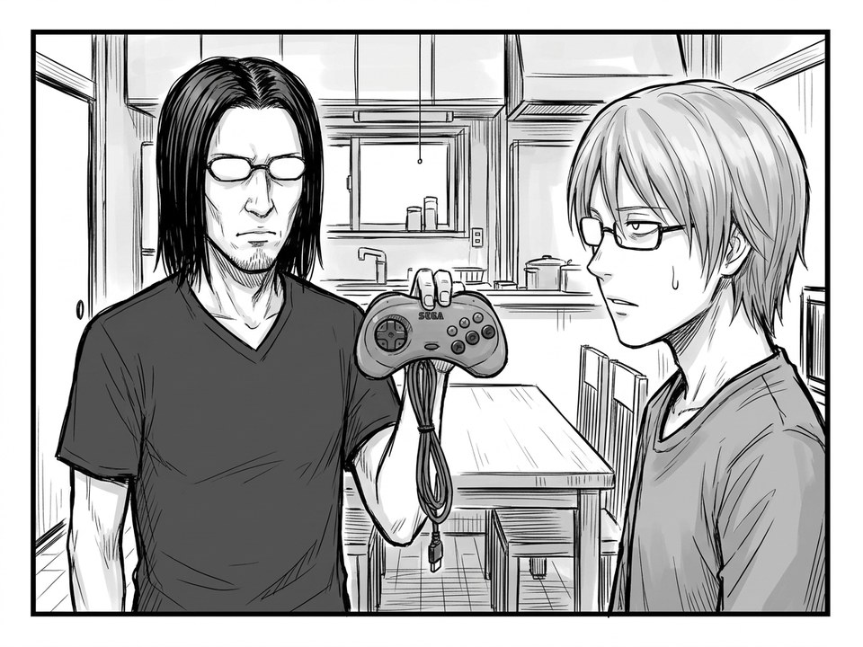
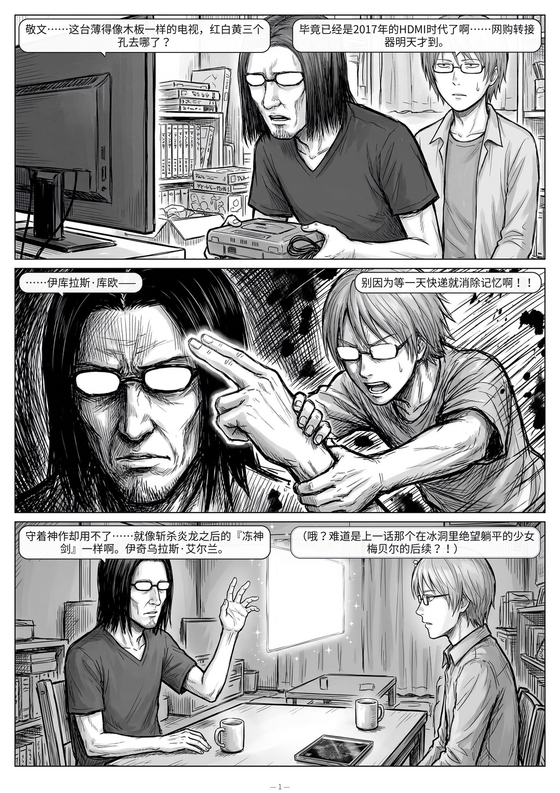
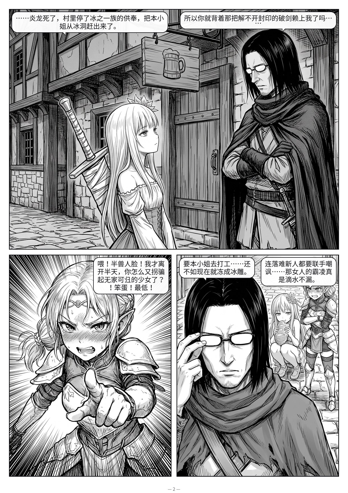
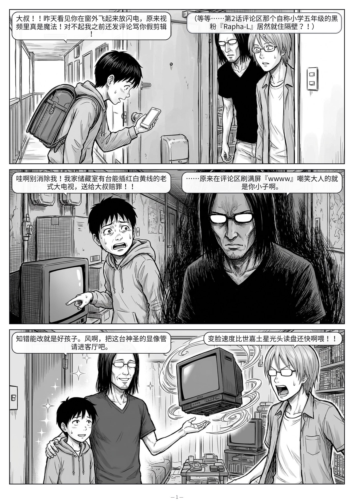
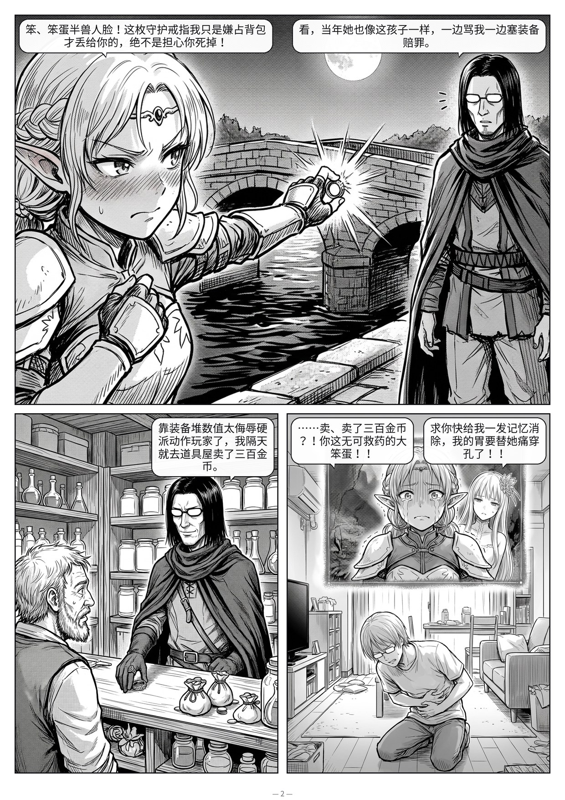

<div align="center">

# MangaForge

让 AI 接着画连载漫画，而不会每过三格就换一张脸、每过两话就忘掉前情。

[English](README.md) · **简体中文**

</div>

大多数“AI 画漫画”的尝试，到第二话就会开始崩：主角画着画着换了个人，关键道具越长越歪，前两话埋的包袱到后面忘得一干二净。

MangaForge 想解决的就是这件事。它不急着直接生图，而是先把已有的连载章节按顺序读一遍——把角色正脸、常穿的衣服、关键道具直接从原漫内页里裁出来存档，把世界观设定和还没填上的坑记进数据库；等真正开始续写下一话时，分镜编剧和生图 Agent 都会带着这些原漫截图和前文记忆去画。如果你突然想看“假如这一话主角选了另一条路”，也可以随时从任意一话分叉出独立的世界线。

---

## 实测：《异世界舅舅》连续续画两期

我们从 MangaDex 抓了《异世界舅舅》(Isekai Ojisan) 的**前 4 话（共 83 页）**喂给系统，让它自己读完原漫后，连续往下编绘**第 5 话**和**第 6 话**。

### 第一步：读原漫，把人脸和道具裁出来留底

读完前 4 话后，系统整理出了格兰巴哈马尔的语言规则、记忆消除咒语、舅舅对世嘉的执念，并自动从黑白内页里裁出了 43 张角色、服装和道具小图：

| 舅舅 | 敬文 | 傲娇精灵 | 梅贝尔 | 世嘉土星手柄 |
| :---: | :---: | :---: | :---: | :---: |
|  |  |  |  |  |

为什么要费劲从原漫里裁图？看下面同一场戏的对比就明白了：

| 只靠文字提示词盲画（未传原漫裁图） | 挂上原漫裁剪的人脸与土星手柄后 |
| :---: | :---: |
|  |  |
| 画成了一个圆眼镜、微卷发的温和帅大叔，连手柄都错画成了三键 MD。 | 贴头皮的黑直长发、反白光的窄框眼镜、凹陷脸颊和尖下巴胡茬，手里也是前 4 话真正的六键土星手柄，排线味道一下就对了。 |

### 第二步：续画第一期（第 5 话）

原作第 4 话停在敬文把一台初代世嘉土星套装送给舅舅当生日礼物。系统续写的第 5 话直接接在五分钟后：舅舅捧着主机跪在 2017 年的液晶电视前，绝望地发现电视上根本没有红白黄三个插孔，差点为了“不用熬过等转接器快递的一天”直接消除自己的记忆；喝茶冷静时又投射出斩杀古代炎龙之后，被赶出冰洞的家里蹲少女梅贝尔赖上自己、正好撞见傲娇精灵吃醋的后续——直到公寓玄关突然响起急促的敲门声。

*（点击任意一页可放大看原图与对白细节）*

| 第 1 页 | 第 2 页 | 第 3 页 |
| :---: | :---: | :---: |
| [](docs/assets/showcase/ep5_p1.jpg) | [](docs/assets/showcase/ep5_p2.jpg) | [](docs/assets/showcase/ep5_p3.jpg) |

### 第三步：接着第 5 话的记忆往下画第二期（第 6 话）

第 5 话成稿后，系统自动把这一话的新剧情和结尾悬念写回记忆库，紧接着生成第 6 话：敬文拦住准备开门消除目击者记忆的舅舅，拉开门发现外面站着住在隔壁的小学五年级男生——正是第 2 话在评论区刷 `wwww` 嘲笑假特效的“Rapha-L”。因为前一天亲眼撞见舅舅在四楼阳台半空放真闪电，小孩吓得搬出爷爷留下的 90 年代大屁股显像管电视来赔罪，顺带歪打正着解决了土星接不上现代电视的难题。

| 第 1 页 | 第 2 页 | 第 3 页 |
| :---: | :---: | :---: |
| [](docs/assets/showcase/ep6_p1.jpg) | [](docs/assets/showcase/ep6_p2.jpg) | [](docs/assets/showcase/ep6_p3.jpg) |

---

## 工作流程


- **看脸认人，而不是只记名字**：读原漫时会顺手框出角色正脸、服装和关键道具裁成参考图，采样画风时也会主动避开单行本第 1 页的彩封（防止彩封把黑白内页带偏成彩漫）。
- **长连载不吃书**：每次写新分镜前，会把固定设定（Story Bible）、滚动压缩的前情提要、最近几话的详细记录和“还没填的坑”一起喂给编剧模型，写完再过一遍连贯性审查，撞设定就打回重改。
- **按分镜比例画图与嵌字排版**：横条格就按宽画幅画，竖格就按竖构图画，不会拿方图硬裁掉半截脑袋；对白气泡、内心独白、旁白框和拟声词会按说话人左右站位分列两侧，直接导出整话 PNG 或 PDF。
- **随时分叉剧情**：章节之间是树状结构而非死板的单线列表，可以从任意一话拉出新分支试写不同走向，记忆和伏笔状态彼此独立。

---

## 本地跑起来

提前装好 [uv](https://docs.astral.sh/uv/)（会自动拉取 Python 3.12）、Node.js 18+ 和 Docker Compose 即可：

```bash
# 1. 安装 Python 与前端依赖
make install

# 2. 复制环境变量模板并填入模型配置
cp .env.example .env

# 3. 启动 MySQL / Redis / MinIO / Qdrant 并执行数据库迁移
make infra && make migrate

# 4. 启动前后端与后台 Worker
make dev      # 前端界面 http://localhost:5173 · 接口文档 http://localhost:8000/docs
make worker   # 另开一个终端跑异步理解与生图任务
```

---

## 支持的生图后端

可以在 `.env` 里改 `IMAGE_BACKEND`，也可以在网页工坊里每次渲染前单独选，所有后端都会接收角色与画风参考图：

| 后端标识 | 说明 |
| :--- | :--- |
| `antigravity` | 调用 Google Antigravity 原生 `image-generator`，支持多张本地角色/道具裁剪参考图（`ImagePaths`）与分格比例匹配 |
| `gemini` | Nano Banana 系列（`gemini-3.1-flash-image` / `gemini-3-pro-image`），单格最多可传 14 张参考图 |
| `openai` | OpenAI Images 接口（如 `gpt-image-2`），通过 `/images/edits` 传入参考图 |
| `custom` | 兼容 OpenAI Images 格式的自定义 HTTP 接口（`IMAGE_API_URL`） |
| `mock` | 本地离线网点灰阶打样，不花额度，适合快速调分镜和气泡位置 |

---

## 更多文档

- 架构与数据表设计：[`docs/architecture.md`](docs/architecture.md) · [`docs/design.md`](docs/design.md) · [`docs/PRD.md`](docs/PRD.md)
- 完整配置项说明：[`.env.example`](.env.example)（不配 Embedding 模型也能跑，检索会自动退化为关键词匹配）
- Swagger 接口调试：启动 `make api` 后访问 `http://localhost:8000/docs`

## License

仅供个人学习与技术研究。导入和处理漫画内容时请尊重原作者版权并遵守当地法律法规。
