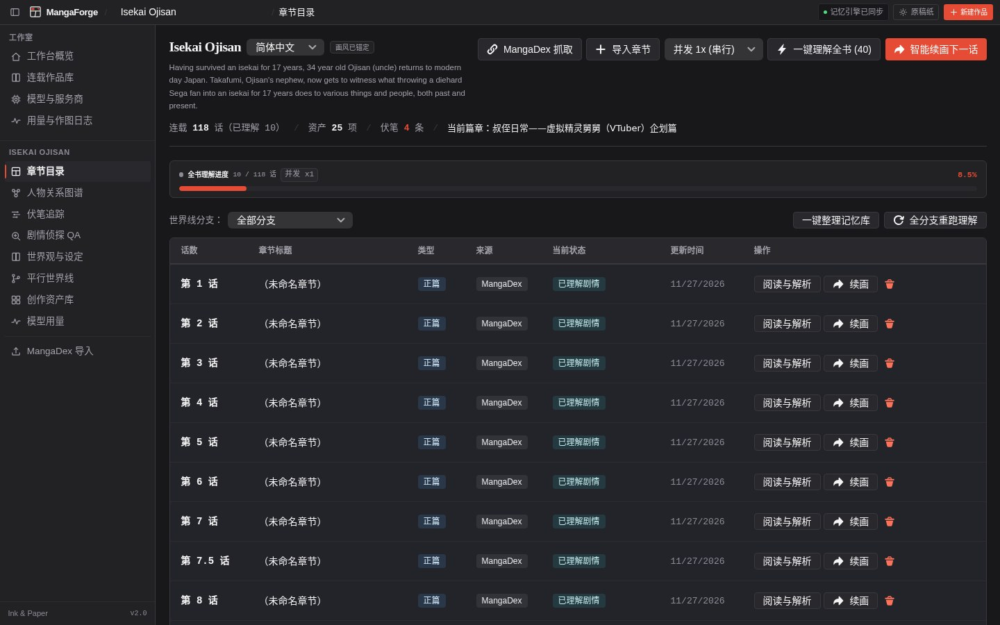
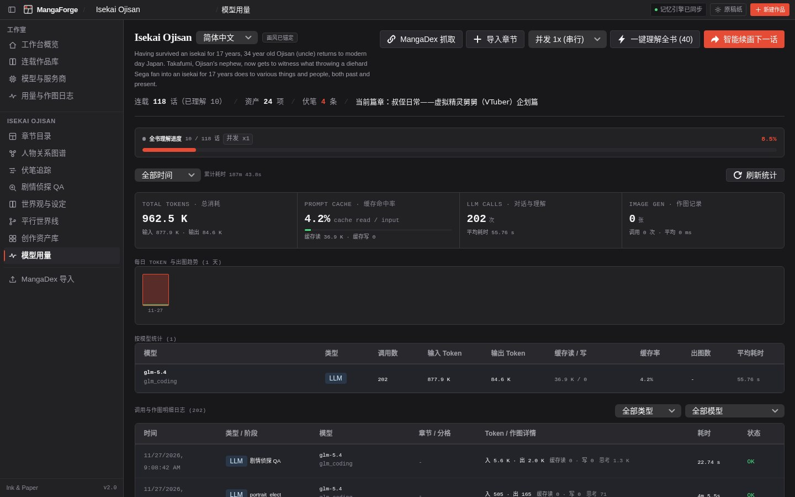
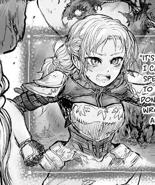
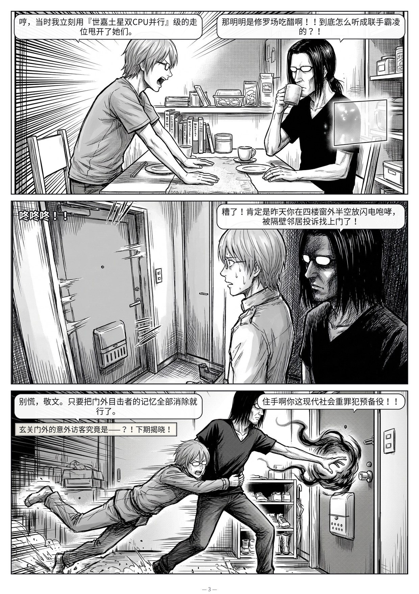
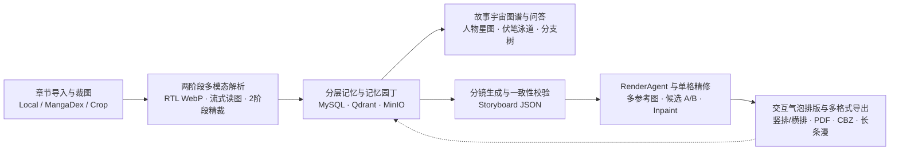

<div align="center">

# MangaForge

开源 AI 漫画续画与剧情知识图谱平台，集成原漫多模态理解、分层长程记忆、故事宇宙可视化、交互式竖排气泡工坊与多格式导出。

[English](README.md) · **简体中文**

[](#本地开发)
[](#系统架构)
[](#系统架构)
[](LICENSE)

</div>

MangaForge 支持从本地图片/压缩包或 MangaDex 导入连载漫画，通过两阶段多模态读图与精裁引擎提取结构化剧情图谱和核验视觉参考图，在交互式「故事宇宙图谱」中可视化人物关系、篇章记忆、伏笔泳道与多世界线分支，并支持基于参考图约束续画、传统日漫竖排/横排交互气泡排版以及 PDF / CBZ / 长条漫一键导出。

## 功能特性

- **两阶段多模态剧情理解与 2 阶段像素精裁引擎**：
  - **高清 WebP 与日漫 RTL 跨页自动拆分**：自动将原画预处理为带顶部页码角标的清晰 WebP，支持日漫跨页右→左（`R → L`）阅读顺序自动拆半与长条漫智能分片。
  - **逐页笔记 → 整话统一合成**：Phase A 顺序流式（`stream=True`）产出逐页笔记（支持 `1360px` 高清放大复核、内容审核单页隔离与超时自动二分降级）；Phase B 一次性整话结构化合成（原生 JSON 模式 + 字符串内引号确定性修复 + 3 次校验修复），并按项目 **首选输出语言** 与 **作品官方通行译名** 锁定全库命名。
  - **红青像素两阶段精裁与联系表自检**：在原图真实像素网格（红 X / 青 Y）粗定位后，对角色头像执行 `50px` 放大精修，通过联系表拼图做视觉自检（`ok` / `adjust` 自动修框 / `reject` 拦截），叠加视觉锚点防串脸守卫与多候选主头像自动竞选淘汰，实现资产库近 100% 核验配图。
  - **实时整体进度条与可配置并发度（`1x～8x`）**：工作台提供全书/批次整体进度条、本话细分阶段条及章节列表 **`理解中 · XX%`** / **`排队等待理解`** 实时状态（`GET /generation/projects/{id}/understand-progress`）。话与话之间始终严格串行保障跨话记忆完整，单话内部读图与裁剪并发度可在页面与模型中心按服务商能力自由调整（`1x` 严格串行零盲区 ～ `8x` 高速并发）。
- **网页端多服务商模型中心（`/models`）与全链路用量观测（`/usage`）**：
  - 内置 11+ 主流平台一键预设（OpenRouter、OpenAI、Anthropic、Gemini、智谱 GLM / Coding Plan、Kimi、DeepSeek、通义千问、ComfyUI、Antigravity、自定义），API Key 经 Fernet 加密存储，支持连通性探测、模型拉取与 **4 角色动态路由**（`main_llm` / `vision_llm` / `image_gen` / `embedding`），免重启实时覆盖 `.env`。
  - 完整记录流式与非流式 LLM、Embedding、生图的 Token 消耗、耗时与 Prompt Cache 命中率。
- **分层长程记忆、多路召回与记忆园丁（Memory Gardener）**：采用“10 话不可变篇章纪要 + 核心/演进分级世界观规则 + 近期章节滑窗 + 多路 RRF 检索（Qdrant 向量检索与中文关键词回退）”架构，配合每 10 话自动触发及一键手动的 **记忆整理园丁**（`POST /projects/{id}/memory/consolidate`）合并重复资产、清理水伏笔并优选主角头像，支持 60～150+ 话长连载不丢失早期设定。
- **角色生命状态迭代与死亡硬锁定**：按分支时间线顺序重放角色 `vital_status` 变更（`存活` / `重伤` / `失踪` / `封印` / `已故`）——角色战死后自动在后续章节的剧本生成与一致性校验中硬锁定禁活，同时在死亡前分叉的平行世界线中自动保持存活，并支持在图谱界面手动覆写。
- **故事宇宙可视化（Story Atlas）与剧情侦探问答**：
  - **人物共现与命运演进星图**：交互式人物关系星图，节点大小按出场话数缩放并内嵌裁剪角色头像（已故角色自动转为黑白肖像并标注 `†`），支持查看服装造型、跨话状态演进轨迹与一键作者状态覆写（`GET /memory/graph`）。
  - **篇章压缩与伏笔生命周期泳道**：集中展示分层世界观法则、篇章纪要、连载时间轴封面与伏笔从埋设 → 线索推进 → 回收闭环的跨话泳道。
  - **平行世界线分支树**：可视化展示各条 `fork` 支线与章节缩略图，支线记忆与伏笔状态严格隔离，支持 `fork` / `diff` / `merge`。
  - **剧情侦探 Story Bible 问答**：严格基于已入库原漫与续画记忆回答剧情考据问题，返回匹配角色头像与可点击跳转的章节引证（`POST /memory/ask`）。
- **精修生图工坊与交互式竖排嵌字**：
  - **`@角色` / `#伏笔` 导演指令芯片**：剧本策划阶段一键插入角色与待填伏笔，分镜生成后自动执行世界观与状态一致性校验。
  - **单格精修重绘、候选 A/B 切换与局部 Inpaint**：无需重跑整话，可单独修改任意分格 Prompt 与参考资产并保留历史候选版本一键切换（`POST /panels/{id}/rerender`、`POST /panels/{id}/select/{image_id}`、`POST /panels/{id}/inpaint`）。
  - **交互式气泡画布与传统日漫竖排**：支持传统从右到左竖排中文/日文嵌字（含竖排标点映射与行头/行尾禁则处理）与现代横排一键切换，内置标准/呐喊尖刺/心声云朵/低语虚线/旁白/SFX 气泡样式，支持页面内直接拖拽调整坐标并毫秒级同步重排（`2480×3508`）。
- **右开单行本阅读器与多格式导出**：提供条漫连读、右开双页单行本（RTL Spread）与网格模式，支持导出 **PDF**、含 `ComicInfo.xml` 元数据的 **CBZ 漫画包** 以及无缝拼接 **Webtoon 长条漫 PNG**。

---

## 功能展示与生成示例

以下为《异世界舅舅》(Isekai Ojisan) 真实端到端工作台运行效果：从 MangaDex 批量抓取 118 话连载，按序解析前 10 话（第 1～9 话含 7.5 话，共 213 页），自动提取 5 名核心角色（盲评均分 9.2/10）、18 项 100% 配图的场景/道具/服装资产（含画风卡共 24 项资产）与 4 条跨话核心伏笔，并支持续画成稿。

### 项目工作台、视觉资产库与多服务商模型中心

| 项目工作台（实时整体进度条与并发调节） | 100% 配图视觉资产库 |
| :---: | :---: |
| [](docs/assets/showcase/project_workbench.jpg) | [](docs/assets/showcase/asset_library.jpg) |

| 多服务商模型中心（4 角色路由与并发配置） | Token 用量与 Prompt Cache 观测面板 |
| :---: | :---: |
| [](docs/assets/showcase/model_hub.jpg) | [](docs/assets/showcase/usage_dashboard.jpg) |

### 故事宇宙图谱与剧情侦探问答

| 人物共现与演进关系星图 | 连载时间轴与伏笔生命周期泳道 |
| :---: | :---: |
| [](docs/assets/showcase/story_atlas_characters.jpg) | [](docs/assets/showcase/story_atlas_timeline.jpg) |

**剧情侦探 Story Bible 实时问答** —— 严格基于已收录章节与伏笔台账作答并附带章节引证卡片：

[](docs/assets/showcase/story_atlas_qa.jpg)

### 交互式气泡精修工坊与右开双页阅读器

| 交互式竖排气泡拖拽精修画布 | 右开双页单行本（RTL Spread）阅读器 |
| :---: | :---: |
| [](docs/assets/showcase/bubble_studio.jpg) | [](docs/assets/showcase/rtl_reader.jpg) |

### 传统日漫竖排 vs. 现代横排嵌字对比（第 5 话第 1 页）

| 横排气泡嵌字 | 传统日漫竖排嵌字（竖排标点 + 禁则换行） |
| :---: | :---: |
| [](docs/assets/showcase/ep5_p1.jpg) | [](docs/assets/showcase/ep5_vertical_p1.jpg) |

### 2 阶段自动精裁角色头像与参考图约束生图对比

| 舅舅 | 敬文 | 精灵 | 梅贝尔 | 藤宫澄夏 |
| :---: | :---: | :---: | :---: | :---: |
|  |  |  |  |  |

| 无参考图（仅文本 Prompt） | 挂载原漫裁剪的角色与道具参考图 |
| :---: | :---: |
|  |  |

### 连续两期续画成稿（第 5 话 & 第 6 话）

第 5 话承接第 4 话结尾生成；第 5 话经 `writeback` 回写记忆与新增伏笔后，基于更新后的上下文继续生成第 6 话（点击任意页面可查看原图）。

**第 5 话**

| 第 1 页 | 第 2 页 | 第 3 页 |
| :---: | :---: | :---: |
| [](docs/assets/showcase/ep5_p1.jpg) | [](docs/assets/showcase/ep5_p2.jpg) | [](docs/assets/showcase/ep5_p3.jpg) |

**第 6 话**

| 第 1 页 | 第 2 页 | 第 3 页 |
| :---: | :---: | :---: |
| [](docs/assets/showcase/ep6_p1.jpg) | [](docs/assets/showcase/ep6_p2.jpg) | [](docs/assets/showcase/ep6_p3.jpg) |

---

## 系统架构



- **后端服务**：Python 3.12、FastAPI、SQLAlchemy 2.0 (async)、Alembic、Pydantic v2、`instructor`
- **异步任务**：Celery + Redis（`understand`、`script`、`render`、`layout`、`writeback`、`mangadex` 队列）
- **存储组件**：MySQL 8.0（业务与记忆数据）、MinIO（原漫页/渲染图/参考图对象存储）、Qdrant（可选向量索引）
- **前端应用**：React 19、TypeScript、Vite、Semi UI、TailwindCSS、TanStack Query、Zustand

---

## 本地开发

### 环境依赖

- [uv](https://docs.astral.sh/uv/)（自动管理 Python 3.12 与虚拟环境）
- Node.js 18+ 与 npm
- Docker 与 Docker Compose

### 启动步骤

```bash
# 1. 安装后端、Worker 与前端依赖（根目录统一创建 .venv）
make install

# 2. 配置环境变量（使用深度思考模型时建议保持 OPENAI_MAX_TOKENS=16384+）
cp .env.example .env

# 3. 启动基础组件（MySQL / Redis / MinIO / Qdrant）并执行数据库迁移
make infra && make migrate

# 4. 启动 API (:8000) 与前端开发服务 (:5173)，并运行 Celery Worker
make dev
make worker   # 在独立终端运行后台任务队列
```

### 代码检查与测试

```bash
make lint                         # ruff + tsc --noEmit
.venv/bin/pytest apps/api/tests/  # 后端单元测试
cd apps/web && npm run build      # 前端生产构建检查
```

---

## 图像生成后端

可通过 `.env` 中的 `IMAGE_BACKEND` 或前端工作台按次/按格指定，所有后端均支持传入匹配的角色、道具与画风参考图：

| `IMAGE_BACKEND` | 对接方式 |
| :--- | :--- |
| `antigravity` | 调用 Antigravity `image-generator`（支持 CLI 或 Bridge 队列），传入本地多参考图 `ImagePaths` 并匹配分格比例 |
| `comfyui` | 对接本地 ComfyUI HTTP 工作流接口（`COMFYUI_URL`、自定义 `COMFYUI_WORKFLOW_PATH` 占位符模板与参考图上传） |
| `gemini` | Google Interactions API（`gemini-3.1-flash-image` / `gemini-3-pro-image`，单格最多 14 张参考图） |
| `openai` | OpenAI Images API（`gpt-image-2` 等，参考图走 `/images/edits`） |
| `custom` | 兼容 OpenAI Images 协议的自定义 HTTP 接口（`IMAGE_API_URL`） |
| `mock` | 本地离线占位渲染器，用于调试分镜脚本与气泡排版 |

---

## 用自己的 Google Flow 账号把单话漫画转为视频

在章节的 **漫画转视频 → 配置 Flow 扩展** 连接浏览器，也可在 **模型中心 → 漫画转视频 · Google Flow** 管理连接。视频使用已有漫画页和本次选择的 Flow 视频模型，无需配置作图引擎。

1. 下载 **MangaForge Flow 扩展（ZIP）** 并解压。在目标 Chrome profile 的 `chrome://extensions` 打开「开发者模式」，选择「加载已解压的扩展程序」并选中含 `manifest.json` 的目录。
2. 点击模型中心的 **生成扩展令牌**。在扩展里填写 MangaForge 地址和令牌，点击 **连接 MangaForge**。
3. 在想用的 Flow 标签页手动选好 Google 账号，再回到章节触发任务。保持浏览器和 Flow 标签页打开，扩展会领取任务、填入参考图与提示词，并回传生成结果。切换 Google 账号后可沿用原令牌。

如果 Flow 弹出素材使用权确认，章节页会显示「等待确认素材使用权」。在弹窗所在的 Flow 标签页点 **I agree** 会继续当前上传，点 **Cancel** 会停止同步。

升级已安装的扩展时，用新版 ZIP 的内容覆盖原目录，在 `chrome://extensions` 点击该扩展的 **重新加载**。现有令牌和任务记录保存在原安装中。若旧版已暂停，在扩展里点 **继续接收任务**。

令牌仅授权该服务商的 Flow 任务，可在模型中心撤销。扩展通过你填写的地址直接访问 MangaForge。在共享网络上使用 HTTPS，并沿用部署对模型中心的访问控制。[Google Flow 官网](https://flow.google.com/)

<details><summary>已有 Python / Ego 连接器</summary>

- **已安装 Ego Lite 的 Mac**。在已连接该 Mac 的 Linux 主机上运行 `ego-browser bridge status`，进入 MangaForge 项目目录运行 `make flow-ego`，按提示粘贴配对串。要指定某个 profile，首次配对或切换时运行 `python3 scripts/flow_ego.py --profile '完整名称'`。同一 profile 可以登录多个 Google 账号。先在 Flow 的账号菜单选好要使用的账号，连接器会固定 profile，并在提交前核对所选账号。如需更换账号，选好后用新的配对串运行 `python3 scripts/flow_ego.py --pair`。Mac 直接向你的 MangaForge 传输素材，需能访问配对串中的服务地址。制作期间保持 Mac 唤醒、Ego Lite、Ego Bridge 和连接器在线。Flow 要求重新登录时，在专用标签页登录后运行 `make flow-ego-resume`。
- **专用 Chrome**。从模型中心下载 Python 连接器，在装有 Chrome 和 Python 3.10+ 的电脑上依次运行 `python -m pip install playwright` 和 `python mangaforge_flow.py`，粘贴配对串，按提示在专用窗口登录 Google。登录失效时用 `--login` 重新登录。

通过 Mac 访问服务器时请用 Mac 可达的局域网或 HTTPS 地址，共享网络请使用 HTTPS。在 Flow 的账号面板核对使用积分的 Google 账号。[Google 的项目与素材管理说明](https://support.google.com/flow/answer/16935308?hl=zh-Hans)

</details>

在章节详情打开 **漫画转视频**，核对各镜头的参考图、修改提示词。**仅同步素材** 会为这部漫画在 Flow 网页新建或复用项目，并上传本话素材。原连接已更换时，点击 **用当前连接重新同步素材** 可重新开始。**生成本话视频** 还会逐镜生成 8 秒片段，消耗 Flow 网页里所选 Google 账号的积分。Worker 监听 `flow` 队列并用 FFmpeg 在本地拼接 MP4。若某个镜头的提交结果待确认，请先在原 Flow 项目核对，再决定是否重试。[Google 的视频生成说明](https://support.google.com/flow/answer/16353334?hl=zh-Hans) · [本地浏览器自动化参考实现](https://github.com/GTAI-1/flow-mcp)

如需用 Nano Banana 绘制新的分镜原画，可以另外在 **原画渲染与作图引擎（image_gen）** 绑定 Flow。

## 相关文档

- 架构设计与演进路线：[`docs/architecture.md`](docs/architecture.md) · [`docs/design.md`](docs/design.md) · [`docs/ROADMAP.md`](docs/ROADMAP.md) · [`docs/PRD.md`](docs/PRD.md)
- 环境变量参考：[`.env.example`](.env.example)（`OPENAI_EMBEDDING_MODEL` 为可选项，留空时自动降级为关键词检索）
- OpenAPI 文档：启动后端后访问 `http://localhost:8000/docs`

## 开源协议

[MIT License](LICENSE)
