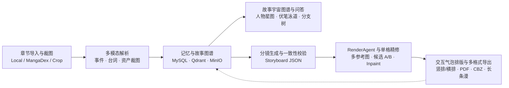

<div align="center">

# MangaForge

开源 AI 漫画续画与剧情知识图谱平台，集成原漫多模态理解、分层长程记忆、故事宇宙可视化、交互式竖排气泡工坊与多格式导出。

[English](README.md) · **简体中文**

[](#本地开发)
[](#系统架构)
[](#系统架构)
[](LICENSE)

</div>

MangaForge 支持从本地图片/压缩包或 MangaDex 导入连载漫画，通过多模态模型提取结构化剧情图谱并裁剪角色与道具参考图，在交互式「故事宇宙图谱」中可视化人物关系、篇章记忆、伏笔泳道与多世界线分支，并支持基于参考图约束续画、传统日漫竖排/横排交互气泡排版以及 PDF / CBZ / 长条漫一键导出。

## 功能特性

- **章节导入与多模态解析**：支持本地文件/ZIP 上传及 MangaDex 批量抓取；自动提取单话摘要、关键事件、人物状态变更、逐页台词与检测框资产裁图，并内置原作页面「框选裁图入资产库」工具（`POST /assets/{id}/crop-from-page`）。
- **分层长程记忆与多路召回**：采用“10 话不可变篇章纪要 + 核心/演进分级世界观规则 + 近期章节滑窗 + 多路 RRF 检索（Qdrant 向量检索与中文关键词回退）”架构，支持 60～150+ 话长连载上下文组装且不丢失早期设定。
- **角色生命状态迭代与死亡硬锁定**：按分支时间线顺序重放角色 `vital_status` 变更（`存活` / `重伤` / `失踪` / `封印` / `已故`）——角色战死后自动在后续章节的剧本生成与一致性校验中硬锁定禁活（即使跨越 50+ 话也不遗忘），同时在死亡前分叉的平行世界线中自动保持存活，并支持在图谱界面手动覆写。
- **故事宇宙可视化（Story Atlas）与剧情侦探问答**：
  - **人物共现与命运演进星图**：交互式人物关系星图，节点大小按出场话数缩放并内嵌裁剪角色头像（已故角色自动转为黑白肖像并标注 `†`），支持查看服装造型、跨话状态演进轨迹与一键作者状态覆写（`GET /memory/graph`）。
  - **篇章压缩与伏笔生命周期泳道**：集中展示分层世界观法则、篇章纪要、连载时间轴封面与伏笔从埋设 → 线索推进 → 回收闭环的跨话泳道。
  - **平行世界线分支树**：可视化展示各条 `fork` 支线与章节缩略图，支线记忆与伏笔状态严格隔离，支持 `fork` / `diff` / `merge`。
  - **剧情侦探 Story Bible 问答**：严格基于已入库原漫与续画记忆回答剧情考据问题（适配深度思考模型高 `OPENAI_MAX_TOKENS` 预算），返回匹配角色头像与可点击跳转的章节引证（`POST /memory/ask`）。
- **精修生图工坊与交互式竖排嵌字**：
  - **`@角色` / `#伏笔` 导演指令芯片**：剧本策划阶段一键插入角色与待填伏笔，分镜生成后自动执行世界观与状态一致性校验。
  - **单格精修重绘、候选 A/B 切换与局部 Inpaint**：无需重跑整话，可单独修改任意分格 Prompt 与参考资产并保留历史候选版本一键切换（`POST /panels/{id}/rerender`、`POST /panels/{id}/select/{image_id}`、`POST /panels/{id}/inpaint`）。
  - **交互式气泡画布与传统日漫竖排**：支持传统从右到左竖排中文/日文嵌字（含竖排标点映射与行头/行尾禁则处理）与现代横排一键切换，内置标准/呐喊尖刺/心声云朵/低语虚线/旁白/SFX 气泡样式，支持页面内直接拖拽调整坐标并毫秒级同步重排（`2480×3508`）。
- **右开单行本阅读器与多格式导出**：提供条漫连读、右开双页单行本（RTL Spread）与网格模式，支持导出 **PDF**、含 `ComicInfo.xml` 元数据的 **CBZ 漫画包** 以及无缝拼接 **Webtoon 长条漫 PNG**。

---

## 功能展示与生成示例

以下为《异世界舅舅》(Isekai Ojisan) 真实端到端工作台运行效果：从 MangaDex 导入第 1～4 话（83 页），自动解析入库 43 项视觉资产、20 条世界观规则与 22 条伏笔，随后连续续画生成第 5 话与第 6 话。

### 故事宇宙图谱与剧情侦探问答

| 人物共现与演进关系星图 | 连载时间轴与伏笔生命周期泳道 |
| :---: | :---: |
| [](docs/assets/showcase/story_atlas_characters.jpg) | [](docs/assets/showcase/story_atlas_timeline.jpg) |

**剧情侦探 Story Bible 实时问答** —— 严格基于已收录章节与伏笔台账作答并附带章节引证卡片：

[](docs/assets/showcase/story_atlas_qa.jpg)

### 交互式气泡精修工坊与右开双页阅读器

| 交互式竖排气泡拖拽精修画布 | 右开双页单行本（RTL Spread）阅读器 |
| :---: | :---: |
| [](docs/assets/showcase/bubble_studio.jpg) | [](docs/assets/showcase/rtl_reader.jpg) |

### 传统日漫竖排 vs. 现代横排嵌字对比（第 5 话第 1 页）

| 横排气泡嵌字 | 传统日漫竖排嵌字（竖排标点 + 禁则换行） |
| :---: | :---: |
| [](docs/assets/showcase/ep5_p1.jpg) | [](docs/assets/showcase/ep5_vertical_p1.jpg) |

### 自动提取视觉参考资产与参考图约束生图对比

| 舅舅 | 敬文 | 傲娇精灵 | 梅贝尔 | SEGA 土星手柄 |
| :---: | :---: | :---: | :---: | :---: |
|  |  |  |  |  |

| 无参考图（仅文本 Prompt） | 挂载原漫裁剪的角色与道具参考图 |
| :---: | :---: |
|  |  |

### 连续两期续画成稿（第 5 话 & 第 6 话）

第 5 话承接第 4 话结尾生成；第 5 话经 `writeback` 回写记忆与新增伏笔后，基于更新后的上下文继续生成第 6 话（点击任意页面可查看原图）。

**第 5 话**

| 第 1 页 | 第 2 页 | 第 3 页 |
| :---: | :---: | :---: |
| [](docs/assets/showcase/ep5_p1.jpg) | [](docs/assets/showcase/ep5_p2.jpg) | [](docs/assets/showcase/ep5_p3.jpg) |

**第 6 话**

| 第 1 页 | 第 2 页 | 第 3 页 |
| :---: | :---: | :---: |
| [](docs/assets/showcase/ep6_p1.jpg) | [](docs/assets/showcase/ep6_p2.jpg) | [](docs/assets/showcase/ep6_p3.jpg) |

---

## 系统架构



- **后端服务**：Python 3.12、FastAPI、SQLAlchemy 2.0 (async)、Alembic、Pydantic v2、`instructor`
- **异步任务**：Celery + Redis（`understand`、`script`、`render`、`layout`、`writeback`、`mangadex` 队列）
- **存储组件**：MySQL 8.0（业务与记忆数据）、MinIO（原漫页/渲染图/参考图对象存储）、Qdrant（可选向量索引）
- **前端应用**：React 19、TypeScript、Vite、Semi UI、TailwindCSS、TanStack Query、Zustand

---

## 本地开发

### 环境依赖

- [uv](https://docs.astral.sh/uv/)（自动管理 Python 3.12 与虚拟环境）
- Node.js 18+ 与 npm
- Docker 与 Docker Compose

### 启动步骤

```bash
# 1. 安装后端、Worker 与前端依赖（根目录统一创建 .venv）
make install

# 2. 配置环境变量（使用深度思考模型时建议保持 OPENAI_MAX_TOKENS=16384+）
cp .env.example .env

# 3. 启动基础组件（MySQL / Redis / MinIO / Qdrant）并执行数据库迁移
make infra && make migrate

# 4. 启动 API (:8000) 与前端开发服务 (:5173)，并运行 Celery Worker
make dev
make worker   # 在独立终端运行后台任务队列
```

### 代码检查与测试

```bash
make lint                         # ruff + tsc --noEmit
.venv/bin/pytest apps/api/tests/  # 后端单元测试
cd apps/web && npm run build      # 前端生产构建检查
```

---

## 图像生成后端

可通过 `.env` 中的 `IMAGE_BACKEND` 或前端工作台按次/按格指定，所有后端均支持传入匹配的角色、道具与画风参考图：

| `IMAGE_BACKEND` | 对接方式 |
| :--- | :--- |
| `antigravity` | 调用 Antigravity `image-generator`（支持 CLI 或 Bridge 队列），传入本地多参考图 `ImagePaths` 并匹配分格比例 |
| `comfyui` | 对接本地 ComfyUI HTTP 工作流接口（`COMFYUI_URL`、自定义 `COMFYUI_WORKFLOW_PATH` 占位符模板与参考图上传） |
| `gemini` | Google Interactions API（`gemini-3.1-flash-image` / `gemini-3-pro-image`，单格最多 14 张参考图） |
| `openai` | OpenAI Images API（`gpt-image-2` 等，参考图走 `/images/edits`） |
| `custom` | 兼容 OpenAI Images 协议的自定义 HTTP 接口（`IMAGE_API_URL`） |
| `mock` | 本地离线占位渲染器，用于调试分镜脚本与气泡排版 |

---

## 相关文档

- 架构设计与演进路线：[`docs/architecture.md`](docs/architecture.md) · [`docs/design.md`](docs/design.md) · [`docs/ROADMAP.md`](docs/ROADMAP.md) · [`docs/PRD.md`](docs/PRD.md)
- 环境变量参考：[`.env.example`](.env.example)（`OPENAI_EMBEDDING_MODEL` 为可选项，留空时自动降级为关键词检索）
- OpenAPI 文档：启动后端后访问 `http://localhost:8000/docs`

## 开源协议

[MIT License](LICENSE)
